# Dokumentasi API — Deera Server

## 1. Info Umum

| Item | Nilai |
|---|---|
| Base URL | `http://localhost:8080` (ganti lewat env `PORT`) |
| Format data | JSON (`Content-Type: application/json`) |
| Header autentikasi | `Authorization: Bearer <token>` |
| Token login | Diperoleh dari `POST /api/login`, berlaku 24 jam |
| Token room | Diperoleh dari `POST /api/rooms/verify` (§5.4), berlaku 1 jam, hanya untuk WebSocket `GET /api/rooms` |
| Koleksi DB | `users`, `quizzes`, `rooms`, `results`, `game_results`, `tokens`, `emojis`, `points`; `transactions` (legacy, tidak ditulis) |
| Batas body | 1 MiB per request (`413` bila lebih) |
| Hashing password | SHA-256 (hex lowercase), dilakukan di sisi klien sebelum dikirim |
| Transport | HTTPS (produksi) melindungi password hash dan token |

Semua endpoint wajib menyertakan header `Authorization` **kecuali** `POST /api/register` dan `POST /api/login`. Endpoint WebSocket `GET /api/rooms?token=<JWT room>` (§9) mewajibkan header `Authorization` (token login) **dan** JWT ber-scope room pada query `token`.

Semua endpoint yang dilindungi `middleware.Auth` (dan `POST /api/login`) menerapkan **allowlist perangkat**: request wajib berasal dari smartphone, dicek dari header `User-Agent`. Request dari selain smartphone ditolak `401`.

Respons `401` dari `middleware.Auth` memakai envelope bersarang `{ "status": 401, "error": "Unauthorized", "message": "..." }`. Pesan `Missing or expired authorization token` dipakai untuk token yang hilang, rusak, atau kedaluwarsa; pesan lain (`Sesi telah berakhir, silakan login kembali`, allowlist device, `User tidak ditemukan`) dipertahankan per kasus. `POST /api/login` yang ditolak karena bukan smartphone masih memakai bentuk lama `{ "message": "..." }`.

**Frontend (`quizrush_app`):** login JWT disimpan di `SharedPreferences` dengan key `auth_token`; objek user disimpan di `auth_user`. Semua service Dart mengambil token lewat `SessionService.instance.getToken()`, lalu `ApiClient` menambahkan `Authorization: Bearer <login JWT>`, `User-Agent` smartphone, dan `Content-Type: application/json` untuk body JSON. Base URL frontend: `https://deera-server.my.id`.

**Environment variables:**

| Env | Wajib | Default | Fungsi |
|---|---|---|---|
| `JWT_SECRET` | ✅ | — (tanpa fallback) | Secret penanda tangan JWT, minimal 32 karakter |
| `MONGO_URI` | ✗* | — | URI MongoDB; *atau isi `DB_HOST/DB_PORT/DB_USER/DB_PASS/DB_NAME/DB_AUTH_SOURCE` |
| `DB_NAME` | ✗ | `quizrush_app_db` | Nama database (hanya dipakai bila `MONGO_URI` tidak menentukan path) |
| `PORT` | ✗ | `8080` | Port HTTP saat `cert.pem` tidak ada |
| `ALLOWED_ORIGINS` | ✗ | origin se-host | Daftar origin yang diizinkan untuk handshake WebSocket (pisahkan koma) |
| `CLEANUP_ORPHAN_COLLECTIONS` | ✗ | `false` | `true` mengizinkan penghapusan koleksi orphan `anggota`/`anggotas` saat startup |
| `CLOUDINARY_URL` | ✗ | — | Kredensial Cloudinary (`cloudinary://<api_key>:<api_secret>@<cloud_name>`); alternatif: `CLOUDINARY_CLOUD_NAME` + `CLOUDINARY_API_KEY` + `CLOUDINARY_API_SECRET`. Kosong = client media tidak aktif (server tetap berjalan) |
| `AI_API_KEY` | ✗ | — | API key penyedia model AI (API gaya OpenAI-compatible). Kosong = `POST /api/ai/suggest` merespons 502 (server tetap berjalan) |
| `AI_BASE_URL` | ✗ | `https://api.openai.com/v1` | Base URL API AI yang mendukung endpoint `/chat/completions` |
| `AI_MODEL` | ✗ | `gpt-4o-mini` | Nama model AI yang dipakai untuk saran soal |
| `BASE_SEPOLIA_RPC_URL` | ✗* | — | RPC Base Sepolia; wajib bersama `WALLET_CONTRACT_ADDRESS` + `WALLET_SIGNER_PRIVATE_KEY` agar klaim on-chain aktif |
| `WALLET_CONTRACT_ADDRESS` | ✗* | — | Alamat kontrak `WalletClaim` address-based yang sudah dideploy |
| `WALLET_SIGNER_PRIVATE_KEY` | ✗* | — | Private key signer (hex, boleh berawalan `0x`); jangan pernah di-commit |
| `WALLET_CHAIN_ID` | ✗ | `84532` | Chain ID Base Sepolia |
| `WALLET_EXPLORER_URL` | ✗ | `https://sepolia.basescan.org` | Base URL explorer untuk helper internal; response wallet tidak lagi memuat `explorer_url` |
| `WALLET_RUPIAH_PER_POINT` | ✗ | `10` | Kurs konversi 1 poin ke rupiah |
| `WALLET_TX_TIMEOUT` | ✗ | `90s` | Batas waktu menunggu receipt transaksi on-chain |

> `*` Klaim on-chain aktif hanya bila `BASE_SEPOLIA_RPC_URL`, `WALLET_CONTRACT_ADDRESS`, dan `WALLET_SIGNER_PRIVATE_KEY` diisi bersamaan. Jika tidak, `POST /api/wallet/claim` membalas `503` dan saldo tidak berubah.
>
> Versi `WalletClaim` di repo ini memakai `applyDelta(address userWallet, string user_id, int256 rupiahDelta, uint256 pointsClaimed)` dan `balancesOf(address)`. Event `BalanceChanged` memakai `userWallet` sebagai indexed address. Riwayat juga tersedia lewat `getMyHistory()`/`getLastMyHistory()` yang membaca `msg.sender`. Kontrak lama harus dideploy ulang; `GET /api/wallet/{user}` membaca event dari alamat kontrak aktif dan mendeteksi blok deploy secara otomatis.

---

## 2. Indeks Endpoint

| Metode | Endpoint | Auth | Fungsi |
|---|---|---|---|
| POST | `/api/register` | ✗ | Mendaftarkan akun baru |
| POST | `/api/login` | ✗ | Login dan mendapatkan token |
| POST | `/api/logout` | ✓ | Mengakhiri sesi token |
| GET | `/api/session` | ✓ | Mengecek sesi login masih aktif |
| GET | `/api/my-quizzes` | ✓ | List kuis milik user (dikelompokkan by status room) |
| POST | `/api/create/signature` | ✓ | Membuat signature Cloudinary untuk upload gambar kuis langsung dari klien |
| POST | `/api/create/quiz` | ✓ | Membuat kuis baru (setelah gambar diunggah ke Cloudinary) |
| GET | `/api/quizzes` | ✓ | List kuis publik (grup: open, in-Game, ended; hanya room `public`, pin ikut; tanpa soal, berisi total soal/durasi/skor) |
| POST | `/api/create/room` | ✓ | Membuat room baru (`type`: `public`/`private`) |
| POST | `/api/rooms/verify` | ✓ | Memverifikasi pin (kode) room |
| PUT | `/api/room/{id}/status` | ✓ | Mengubah status room (memulai/menghentikan permainan) |
| POST | `/api/room/{kode}/answer` | ✓ | Mengirim jawaban satu soal pada permainan yang berjalan |
| POST | `/api/room/{kode}/result` | ✓ | Membuat result untuk room |
| GET | `/api/room/{kode}/result` | ✓ | Melihat result berdasarkan kode room |
| PUT | `/api/room/{kode}/result` | ✓ | Update/upsert scoreboard result |
| GET | `/api/results` | ✓ | List semua result |
| POST | `/api/ai/suggest` | ✓ | Membuat saran soal (AI) dari topik teks |
| GET | `/api/me/points` | ✓ | Saldo poin user yang login |
| GET | `/api/wallet/{user}` | ✓ | Saldo rupiah on-chain dan riwayat transaksi wallet dari event `BalanceChanged` |
| POST | `/api/wallet/claim` | ✓ | Tukar poin / kurangi rupiah on-chain; tulis ledger `redeem` setelah transaksi sukses |
| GET | `/api/location` | ✓ | Grouped leaderboard per kecamatan/kota/provinsi dari koordinat GPS (lihat §11) |
| GET | `/api/emojis` | ✓ | List semua emoji |
| GET | `/api/emojis/{id}` | ✓ | Melihat satu emoji berdasarkan ID |
| POST | `/api/emojis` | ✓ | Membuat emoji baru |
| GET | `/api/rooms?token=<JWT room>` | ✓ | Koneksi WebSocket room (header login + JWT room) |

### 2.1 Daftar Fitur

| No Fitur | Fitur | Section |
|---|---|---|
| 1 | Auth | §3 |
| 2 | Quiz | §4 |
| 3 | Room | §5 |
| 4 | Result | §6 |
| 5 | AI | §7 |
| 6 | Emoji | §8 |
| 7 | WebSocket & Permainan | §9 |
| 8 | Poin & Rupiah | §10 |
| 9 | Grouped Leaderboard Wilayah (LBS) | §11 |
| 10 | Dompet & Klaim On-chain | §14–§15 |
| — | Kode Error Umum | §12 |
| — | Ringkasan Alur Token | §13 |

---

## 3. Auth

### 3.1 POST /api/register

| Metode | Path | Auth |
|---|---|---|
| POST | `/api/register` | ✗ |

**Request body:**

| No | Field | Tipe | Wajib | Deskripsi |
|---|---|---|---|---|
| 1 | `username` | string | ✅ | Username unik (min 3 karakter: huruf, angka, underscore, atau dash) |
| 2 | `nama` | string | ✅ | Nama lengkap |
| 3 | `kelas` | string | ✅ | Nama kelas |
| 4 | `password` | string | ✅ | Password dalam bentuk hash **SHA-256** (hex lowercase 64 karakter), bukan plaintext |
| 5 | `tanggal_lahir` | string | ✅ | Format `YYYY-MM-DD`, tidak boleh di masa depan |

**Contoh request:**

```http
POST /api/register HTTP/1.1
Host: localhost:8080
Content-Type: application/json

{
  "username": "124240200",
  "nama": "Budi Santoso",
  "kelas": "Pemrograman Mobile SI-B",
  "password": "bee5688aea66a47460b19c76f8f199c6b9585eb726f8322b1429793863609ca2",
  "tanggal_lahir": "2004-03-10"
}
```

> **Catatan hashing:** klien meng-hash password dengan SHA-256 sebelum dikirim
> (`password` = `SHA256(plaintext)` di atas). Server menyimpan/membandingkan nilai
> hash tersebut. Pengiriman tetap melalui HTTPS.

**Response:**

| Status | Deskripsi |
|---|---|
| 201 | Berhasil |
| 400 | Wajib diisi / format salah |
| 400 | Username tidak valid (min 3 karakter, hanya huruf, angka, underscore, atau dash) |
| 400 | Tanggal lahir masa depan |
| 400 | Format tanggal salah |
| 409 | Username sudah terdaftar |
| 500 | Error server |

**Contoh response — `201 Created`**

```json
{
  "message": "Akun berhasil dibuat",
  "user": {
    "username": "124240200",
    "nama": "Budi Santoso",
    "kelas": "Pemrograman Mobile SI-B",
    "tanggal_lahir": "2004-03-10"
  }
}
```

**Contoh response — `400 Bad Request`**

```json
// Wajib diisi / format salah
{ "message": "Username, nama, kelas, password, dan tanggal lahir wajib diisi" }

// Username tidak valid
{ "message": "Username minimal 3 karakter, hanya huruf, angka, underscore, atau dash" }

// Tanggal lahir masa depan
{ "message": "Tanggal lahir tidak boleh di masa depan" }

// Format tanggal salah
{ "message": "Format tanggal lahir harus YYYY-MM-DD" }
```

**Contoh response — `409 Conflict`**

```json
{ "message": "Username sudah terdaftar" }
```

**Contoh response — `500 Internal Server Error`**

```json
{ "message": "Gagal membuat akun" }
```

### 3.2 POST /api/login

| Metode | Path | Auth |
|---|---|---|
| POST | `/api/login` | ✗ |

**Request body:**

| No | Field | Tipe | Wajib | Deskripsi |
|---|---|---|---|---|
| 1 | `username` | string | ✅ | Username user |
| 2 | `password` | string | ✅ | Password dalam bentuk hash **SHA-256** (hex lowercase 64 karakter), bukan plaintext |
| 3 | `device_id` | string | ✅ | ID perangkat; mengikat username ke perangkat ini (lihat catatan di bawah) |

**Contoh request:**

```http
POST /api/login HTTP/1.1
Host: localhost:8080
Content-Type: application/json

{
  "username": "124240200",
  "password": "bee5688aea66a47460b19c76f8f199c6b9585eb726f8322b1429793863609ca2",
  "device_id": "android-3f9c1d7b"
}
```

> **Catatan hashing:** klien meng-hash password dengan SHA-256 sebelum dikirim
> (`password` = `SHA256(plaintext)`, contoh di atas untuk `rahasia123`). Server
> membandingkan nilai hash tersebut. Pengiriman tetap melalui HTTPS.

**Response:**

| Status | Deskripsi |
|---|---|
| 200 | Berhasil, dapat token |
| 400 | Wajib diisi (username, password, device_id) |
| 401 | Bukan dari perangkat smartphone (allowlist device) |
| 401 | Username/password salah |
| 403 | Akun sudah terikat pada perangkat lain |
| 413 | Body terlalu besar (> 1 MiB) |
| 415 | Content-Type bukan JSON |
| 429 | Terlalu banyak percobaan login gagal (5 per IP+username per 5 menit; lihat header `Retry-After`) |
| 500 | Error server |

**Contoh response — `200 OK`**

```json
{
  "token": "<JWT>",
  "user": {
    "username": "124240200",
    "nama": "Budi Santoso",
    "kelas": "Pemrograman Mobile SI-B",
    "points": 120
  }
}
```

**Contoh response — `400 Bad Request`**

```json
{ "message": "Username, password, dan device_id wajib diisi" }
```

**Contoh response — `401 Unauthorized`**

```json
// Bukan dari smartphone
{ "message": "Akses hanya diizinkan dari perangkat smartphone" }

// Username/password salah
{ "message": "Username atau password salah" }
```

**Contoh response — `403 Forbidden`**

```json
{ "message": "Akun sudah terikat pada perangkat lain" }
```

**Contoh response — `500 Internal Server Error`**

```json
{ "message": "Gagal membuat token" }
```

> **Device binding:** saat login sukses, `device_id` disimpan pada user. Jika
> user yang sama login kembali, `device_id` harus sama; bila berbeda, ditolak `403`.
> `device_id` tidak dikembalikan pada objek `user`. Objek `user` pada `POST /api/login`, `GET /api/session`, dan `POST /api/register` menyertakan `points` dari cache `users.points`. Cache ini tidak lagi diperbarui oleh hadiah game maupun klaim; saldo poin otoritatif dihitung dari ledger `points` lewat `GET /api/me/points` (lihat §10).

### 3.3 POST /api/logout

| Metode | Path | Auth |
|---|---|---|
| POST | `/api/logout` | ✓ |

Tidak ada request body.

**Contoh request:**

```http
POST /api/logout HTTP/1.1
Host: localhost:8080
Authorization: Bearer <TOKEN>
```

**Response:**

| Status | Deskripsi |
|---|---|
| 200 | Berhasil logout |
| 401 | Token tidak ditemukan |
| 401 | Token tidak valid |
| 401 | Sesi sudah berakhir |
| 500 | Error server |

**Contoh response — `200 OK`**

```json
{ "message": "Logout berhasil, sesi berakhir" }
```

**Contoh response — `401 Unauthorized`**

```json
// Token tidak ditemukan / tidak valid / kedaluwarsa
{ "status": 401, "error": "Unauthorized", "message": "Missing or expired authorization token" }

// Sesi sudah berakhir
{ "status": 401, "error": "Unauthorized", "message": "Sesi telah berakhir, silakan login kembali" }
```

**Contoh response — `500 Internal Server Error`**

```json
{ "message": "Gagal menghapus sesi" }
```

### 3.4 GET /api/session

| Metode | Path | Auth |
|---|---|---|
| GET | `/api/session` | ✓ |

Tidak ada request parameter maupun body.

**Contoh request:**

```http
GET /api/session HTTP/1.1
Host: localhost:8080
Authorization: Bearer <TOKEN>
```

**Response:**

| Status | Deskripsi |
|---|---|
| 200 | Sesi valid |
| 401 | Token tidak valid / sesi berakhir / bukan smartphone / user tidak ditemukan |

**Contoh response — `200 OK`**

```json
{
  "valid": true,
  "user": {
    "username": "124240200",
    "nama": "Budi Santoso",
    "kelas": "Pemrograman Mobile SI-B",
    "points": 120
  }
}
```

**Contoh response — `401 Unauthorized`**

```json
// Token tidak valid / kedaluwarsa
{ "status": 401, "error": "Unauthorized", "message": "Missing or expired authorization token" }

// Sesi berakhir
{ "status": 401, "error": "Unauthorized", "message": "Sesi telah berakhir, silakan login kembali" }

// User tidak ditemukan
{ "status": 401, "error": "Unauthorized", "message": "User tidak ditemukan" }
```

### 3.5 Alur Token — Auth

| Endpoint | Token yang dikirim | Token yang diterbitkan | Keterangan |
|---|---|---|---|
| `POST /api/register` | — | — | Hanya membuat akun; tidak ada sesi/token |
| `POST /api/login` | — | Login JWT (24 jam) | Token ditandatangani HS256 dan hash-nya disimpan di `tokens` |
| `GET /api/session` | Login JWT | — | Memvalidasi sesi dan mengembalikan user dari context |
| `POST /api/logout` | Login JWT | — | Mencabut token aktif (`tokens.revoked_at`) |

**Langkah alur token:**

1. Klien memanggil `POST /api/register` tanpa `Authorization`. Server tidak menerbitkan token; klien harus login setelah registrasi.
2. Klien memanggil `POST /api/login` dengan `username`, `password`, dan `device_id` tanpa `Authorization`. Server memeriksa allowlist smartphone, rate limit, kredensial, dan device binding.
3. Login sukses: server membuat login JWT HS256 dengan klaim `sub` (username), `iat`, dan `exp` 24 jam, lalu menyimpan `SHA256(token)` di koleksi `tokens` bersama `user_id` dan `expires_at`.
4. Untuk endpoint terlindungi, klien mengirim `Authorization: Bearer <login JWT>`.
5. `middleware.Auth` memverifikasi signature/exp, menolak token ber-`typ="room"`, mengecek `revoked_at`, memeriksa allowlist smartphone, lalu memuat user dari klaim `sub` ke context.
6. `GET /api/session` hanya membaca user dari context dan mengembalikan `{ valid: true, user }`.
7. `POST /api/logout` memakai token dari context lalu menulis `revoked_at` pada record token tersebut. Token yang sudah dicabut atau kedaluwarsa harus diganti dengan login baru.

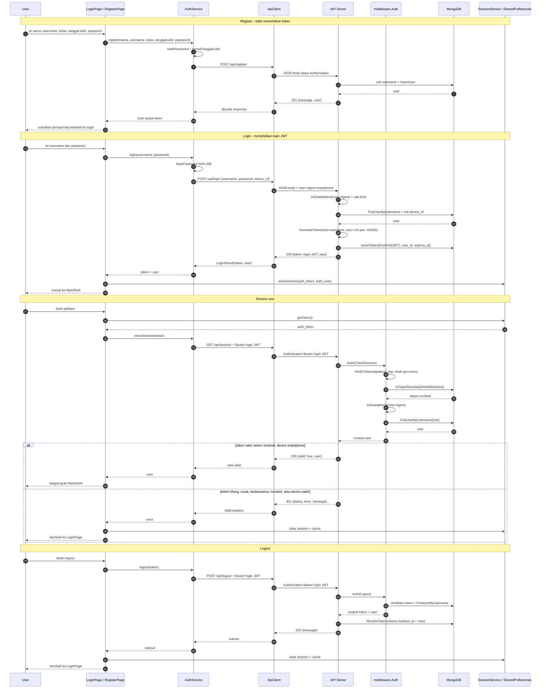

> Login JWT berlaku 24 jam dan dapat dicabut lewat logout. `JWT_SECRET` yang sama dipakai untuk login JWT dan room JWT, tetapi klaim `typ="room"` membuat room JWT tidak bisa dipakai sebagai Bearer di `middleware.Auth`.

**Alur frontend `quizrush_app` → server:**

| File frontend | Variabel/state | Isi yang dikirim |
|---|---|---|
| `lib/pages/login_page.dart` | `_usernameController.text.trim()` | `username` |
| `lib/pages/login_page.dart` | `_passwordController.text` | plaintext, lalu di-hash `SHA-256` |
| `lib/services/api/auth_service.dart` | `passwordHash` | hasil `hashPassword(password)` |
| `lib/services/device_service.dart` | `DeviceService.instance.getId()` | `device_id` (`dev-<fnv1a>`) |
| `lib/services/api/api_client.dart` | `headers()` | `User-Agent` smartphone; `Authorization` bila token ada |
| `lib/services/session_service.dart` | `auth_token`, `auth_user` | disimpan setelah login berhasil |
| `lib/pages/regis_page.dart` | controller nama/username/kelas/tanggal/password | body register; tanggal dikonversi `dd/mm/yyyy` → `YYYY-MM-DD` |

1. `LoginPage._login()` memvalidasi `_usernameController` dan `_passwordController`, lalu memanggil `AuthService.login(username, password)`.
2. `AuthService.login()` memanggil `hashPassword()` (SHA-256 hex lowercase), lalu `loginWithHash()` mengirim body `{username, password: passwordHash, device_id}` melalui `ApiClient.post`.
3. `ApiClient.headers()` menambahkan `User-Agent` smartphone dari `DeviceService.instance.userAgent`; `device_id` dibuat stabil dari platform (`dev-...`).
4. Respons `200` diubah menjadi `LoginResult(token, user)`. `LoginPage` menyimpan `token` ke `SharedPreferences` key `auth_token` dan `user` ke `auth_user` lewat `SessionService.saveSession`.
5. Saat aplikasi dibuka kembali, `LoginPage._restoreSession()` mengambil `auth_token` lalu memanggil `AuthService.checkSession(token)`. Bila `checkSession` melempar error apa pun (`401`, timeout, atau masalah jaringan), `SessionService.clear()` dan `ActiveRoomService.clear()` dijalankan, lalu user diarahkan ke login.
6. `RegisterPage._register()` mengisi `nama`, `username`, `kelas`, `tanggalLahir` (hasil `formatTanggalLahir`), dan `password`; `AuthService.register()` mengirim password yang sudah di-hash. Register **tidak** menyimpan token.
7. Login biometrik memakai `loginWithHash()` dengan hash yang tersimpan, bukan plaintext. Logout di `ProfilePage._logout()` mengirim `AuthService.logout(token)`, lalu tetap menghapus sesi lokal dan cache walaupun server tidak terjangkau.

**Output ke UI:**

| Kondisi | Output |
|---|---|
| Register berhasil | Snackbar registrasi berhasil, lalu kembali ke halaman login; token belum dibuat |
| Login berhasil | `SessionService.saveSession()` lalu `pushReplacement(MainShell(user))` |
| Restore berhasil | Langsung ke `MainShell` dengan user dari `/api/session` |
| Restore gagal | Sesi lokal dihapus dan user kembali ke `LoginPage` |
| Logout | `AuthService.logout()` dipanggil; sesi lokal, cache quiz, dan `ActiveRoomService` tetap dibersihkan lalu redirect ke login |
| Login/register gagal | Snackbar berisi pesan `ApiException` atau pesan koneksi |

---

## 4. Quiz

### 4.1 GET /api/my-quizzes

| Metode | Path | Auth |
|---|---|---|
| GET | `/api/my-quizzes` | ✓ |

Tidak ada request parameter. Response hanya kuis milik user yang login (identitas diambil otomatis dari token, sehingga tidak bisa dilihat oleh user lain).

Response dikelompokkan ke **5 grup** berdasarkan status room paling terakhir dibuat:
`waiting`, `open`, `in-Game`, `ended`, dan `quarantine` (kuis yang belum punya room sama sekali).
Setiap kuis muncul hanya di **satu** grup; room di dalam kuis diurutkan ascending (kecil → besar) by `created_at`, dan urutan kuis di tiap grup berdasarkan `created_at` kuis (terbaru di atas).

**Contoh request:**

```http
GET /api/my-quizzes HTTP/1.1
Host: localhost:8080
Authorization: Bearer <TOKEN>
```

**Response:**

| Status | Deskripsi |
|---|---|
| 200 | List kuis milik sendiri (dikelompokkan by status room) |
| 401 | Token tidak valid / sesi berakhir / bukan smartphone |
| 401 | User tidak ditemukan |

**Contoh response — `200 OK`**

```json
{
  "waiting": [
    {
      "id": "<id>",
      "user_id": "<user_id>",
      "title": "Kuis Pemrograman Mobile",
      "description": "Dasar Flutter & Dart",
      "path": "https://res.cloudinary.com/quiz/image/authenticated/s--abc123--/v123/galery-quiz/quiz-image/kuis-mobile.png",
      "questions": [
        {
          "question": "Bahasa pemrograman utama Flutter?",
          "options": ["Kotlin", "Dart", "Swift", "Java"],
          "duration": 1.5,
          "skor": 20
        }
      ],
      "created_at": "2026-09-17T10:00:00Z",
      "status": "waiting",
      "rooms": [
        {
          "id": "<room_id>",
          "judul": "Room Soal Flutter",
          "isi": "Kumpulan soal dasar Flutter & Dart untuk persiapan ujian.",
          "kode": "482913",
          "status": "waiting",
          "type": "public",
          "created_at": "2026-09-17T10:00:00Z"
        }
      ]
    }
  ],
  "open": [],
  "in-Game": [],
  "ended": [],
  "quarantine": [
    {
      "id": "<id>",
      "user_id": "<user_id>",
      "title": "Kuis Basis Data MongoDB",
      "description": "Konsep dasar MongoDB",
      "path": "https://res.cloudinary.com/quiz/image/authenticated/s--abc123--/v123/galery-quiz/quiz-image/kuis-mongodb.png",
      "questions": [
        {
          "question": "MongoDB termasuk database jenis apa?",
          "options": ["SQL", "Redis", "NoSQL", "GraphQL"],
          "duration": 2,
          "skor": 20
        }
      ],
      "created_at": "2026-09-16T08:00:00Z",
      "rooms": []
    }
  ]
}
```

> `status` pada kuis = status room yang paling terakhir dibuat; field ini dihilangkan (`omitempty`) jika kuis belum punya room (masuk grup `quarantine`). `path` berisi URL gambar kuis hasil unggahan Cloudinary (lihat §4.2–§4.4). `correct_idx` tidak dikembalikan pada response untuk menjaga jawaban benar tetap rahasia. Tiap room memuat `type` (`public` atau `private`); room lama tanpa field `type` ditampilkan sebagai `public`.

**Contoh response — `401 Unauthorized`**

```json
// Token tidak valid / kedaluwarsa
{ "status": 401, "error": "Unauthorized", "message": "Missing or expired authorization token" }

// Sesi berakhir
{ "status": 401, "error": "Unauthorized", "message": "Sesi telah berakhir, silakan login kembali" }

// Bukan dari smartphone
{ "status": 401, "error": "Unauthorized", "message": "Akses hanya diizinkan dari perangkat smartphone" }

// User tidak ditemukan
{ "status": 401, "error": "Unauthorized", "message": "User tidak ditemukan" }
```

---

### 4.2 POST /api/create/signature

| Metode | Path | Auth |
|---|---|---|
| POST | `/api/create/signature` | ✓ |

Endpoint ini digunakan klien untuk meminta tanda tangan digital (*signature*) resmi dari server
sebelum mengunggah gambar langsung ke Cloudinary. Signature ditandatangani dari parameter
`folder`, `timestamp` (waktu server saat ini, format desimal basis 10), dan `type`
(selalu `authenticated`) memakai API secret Cloudinary; API secret itu sendiri **tidak pernah**
dikembalikan.

**Request body:**

| No | Field | Tipe | Wajib | Deskripsi |
|---|---|---|---|---|
| 1 | `folder` | string | ✅ | Folder tujuan aset di Cloudinary; harus `galery-quiz/quiz-image` |

**Contoh request:**

```http
POST /api/create/signature HTTP/1.1
Host: localhost:8080
Authorization: Bearer <TOKEN>
Content-Type: application/json

{
  "folder": "galery-quiz/quiz-image"
}
```

**Response:**

| Status | Deskripsi |
|---|---|
| 200 | Sukses menghasilkan signature |
| 400 | `folder` kosong atau bukan folder yang diizinkan |
| 401 | Token tidak valid / sesi berakhir / bukan smartphone |
| 413 | Body terlalu besar (> 1 MiB) |
| 415 | Content-Type bukan JSON |
| 500 | Gagal membuat signature (konfigurasi Cloudinary belum lengkap) |

**Contoh response — `200 OK`**

```json
{
  "success": true,
  "signature": "81f14371fa77c3852cd1d6ebbe382cf8476aa081",
  "timestamp": 1792154580,
  "apiKey": "123456789012345",
  "cloudName": "dlxxyz123",
  "type": "authenticated"
}
```

> `apiKey` dan `cloudName` adalah kredensial publik; `signature` dihitung dari `folder` +
> `timestamp` + `type` (SHA-1). Klien mengirim ulang `api_key`, `timestamp`, `signature`, `folder`,
> dan `type` yang sama saat upload ke Cloudinary (§4.3). Karena `timestamp` diambil saat
> permintaan, signature hanya berlaku dalam jendela waktu singkat yang diterima Cloudinary.
>
> **Penting:** seluruh field yang ditandatangani (kecuali `file`, `cloud_name`,
> `resource_type`, dan `api_key`) harus dikirim utuh saat upload. Kalau ada field yang
> ditandatangani tapi tidak dikirim — atau sebaliknya — Cloudinary akan membalas
> `401 Invalid Signature`.

**Contoh response — `400 Bad Request`**

```json
// folder kosong
{ "message": "folder wajib diisi" }

// folder bukan folder yang diizinkan
{ "message": "folder tidak diizinkan" }
```

---

### 4.3 POST /image/upload (Direct to Cloudinary)

| Metode | Path | Auth |
|---|---|---|
| POST | `https://api.cloudinary.com/v1_1/<cloudName>/image/upload` | ✗ |

Endpoint ini disediakan langsung oleh Cloudinary. Klien mengirimkan file asli (*binary*) ke URL
ini menggunakan data otorisasi yang didapatkan dari endpoint `POST /api/create/signature` (§4.2).

**Request body (multipart/form-data):**

| No | Field | Tipe | Wajib | Deskripsi |
|---|---|---|---|---|
| 1 | `file` | file (binary) | ✅ | File fisik gambar kuis (`jpg`/`jpeg`/`png`/`webp`), maksimal 5 MB |
| 2 | `api_key` | string | ✅ | Diambil dari field `apiKey` hasil respons endpoint `/api/create/signature` |
| 3 | `timestamp` | int | ✅ | Diambil dari field `timestamp` hasil respons endpoint `/api/create/signature` |
| 4 | `signature` | string | ✅ | Diambil dari field `signature` hasil respons endpoint `/api/create/signature` |
| 5 | `folder` | string | ✅ | **Wajib sama** dengan folder yang dikirim pada endpoint `/api/create/signature` |
| 6 | `type` | string | ✅ | **Wajib sama** dengan field `type` hasil respons endpoint `/api/create/signature` (saat ini `authenticated`) |

**Contoh request:**

```http
POST /v1_1/dlxxyz123/image/upload HTTP/1.1
Host: api.cloudinary.com
Content-Type: multipart/form-data; boundary=----WebKitFormBoundary

------WebKitFormBoundary
Content-Disposition: form-data; name="api_key"

123456789012345
------WebKitFormBoundary
Content-Disposition: form-data; name="timestamp"

1792154580
------WebKitFormBoundary
Content-Disposition: form-data; name="signature"

81f14371fa77c3852cd1d6ebbe382cf8476aa081
------WebKitFormBoundary
Content-Disposition: form-data; name="folder"

galery-quiz/quiz-image
------WebKitFormBoundary
Content-Disposition: form-data; name="type"

authenticated
------WebKitFormBoundary
Content-Disposition: form-data; name="file"; filename="kuis-mobile.png"
Content-Type: image/png

<isi biner gambar>
------WebKitFormBoundary--
```

**Response (JSON — `200 OK`):**
Klien wajib menangkap nilai `public_id` dan `format` pada respons ini untuk dikirimkan ke
backend sebagai `image_id` dan `image_format` (§4.4).

```json
{
  "asset_id": "8347f3b8918c5e7b23c56d78a912e34d",
  "public_id": "galery-quiz/quiz-image/kuis-mobile",
  "format": "png",
  "resource_type": "image",
  "secure_url": "https://res.cloudinary.com/dlxxyz123/image/upload/v1792154580/galery-quiz/quiz-image/kuis-mobile.png"
}
```

> Aset diunggah dengan `type=authenticated`, jadi `secure_url` di atas tidak dapat dibuka
> langsung. Backend menyusun ulang URL yang bisa dipakai klien dari `public_id` + `format`
> (§4.4).

---

### 4.4 POST /api/create/quiz

| Metode | Path | Auth |
|---|---|---|
| POST | `/api/create/quiz` | ✓ |

Endpoint ini dipanggil setelah klien berhasil mengunggah gambar ke Cloudinary (§4.3). Klien
mengirimkan `public_id` dan `format` aset pada field **`image_id`** dan **`image_format`**;
backend menyimpannya dan menyusun ulang signed URL `authenticated` yang dikembalikan pada
field `path`.

Untuk submit kuis yang berhasil, klien wajib mengirimkan **minimal 5 soal** dan format data berupa **`application/json`**.

**Request body:**

| No | Field | Tipe | Wajib | Deskripsi |
|---|---|---|---|---|
| 1 | `title` | string | ✅ | Judul kuis |
| 2 | `description` | string | ✗ | Deskripsi kuis |
| 3 | `image_id` | string | ✅ | `public_id` aset gambar hasil balikan Cloudinary (tanpa ekstensi) |
| 4 | `image_format` | string | ✅ | Format aset gambar hasil balikan Cloudinary, misalnya `png` atau `jpg` |
| 5 | `questions` | array | ✅ | Array berisi objek pertanyaan, minimal 5 soal |
| 6 | `questions[].question` | string | ✅ | Teks pertanyaan soal |
| 7 | `questions[].options` | array\[4\] | ✅ | Tepat 4 opsi pilihan jawaban |
| 8 | `questions[].correct_idx` | int | ✅ | Index jawaban yang benar (rentang 0–3) |
| 9 | `questions[].duration` | float | ✅ | Durasi pengerjaan soal. Harus salah satu dari: `1.5`, `2`, `3`, `5` detik |
| 10 | `questions[].skor` | int | ✅ | Skor bobot soal, wajib berada di antara rentang 1–50 |

**Contoh request:**

```http
POST /api/create/quiz HTTP/1.1
Host: localhost:8080
Authorization: Bearer <TOKEN>
Content-Type: application/json

{
  "title": "Kuis Pemrograman Mobile",
  "description": "Dasar Flutter & Dart",
  "image_id": "galery-quiz/quiz-image/kuis-mobile",
  "image_format": "png",
  "questions": [
    {
      "question": "Bahasa pemrograman utama Flutter?",
      "options": ["Kotlin", "Dart", "Swift", "Java"],
      "correct_idx": 1,
      "duration": 1.5,
      "skor": 20
    }
  ]
}
```

> **Catatan Singkat:** Contoh request di atas hanya mengilustrasikan 1 soal demi ringkasnya dokumen. Validasi sistem tetap mewajibkan minimal **5 soal**.

**Response:**

| Status | Deskripsi |
|---|---|
| 201 | Kuis berhasil dibuat |
| 400 | `title` / `image_id` / `image_format` kosong atau tidak valid |
| 400 | Jumlah soal di dalam `questions` kurang dari 5 |
| 400 | Properti `question` pada soal ke-n kosong |
| 400 | Jumlah item `options` pada soal ke-n tidak tepat 4 |
| 400 | Nilai `correct_idx` pada soal ke-n berada di luar rentang 0-3 |
| 400 | Nilai `duration` pada soal ke-n tidak sesuai pilihan yang diizinkan |
| 400 | Nilai `skor` pada soal ke-n berada di luar rentang 1-50 |
| 401 | Token tidak valid / sesi berakhir / bukan smartphone |
| 415 | Content-Type bukan JSON |
| 500 | Gagal menyimpan data kuis ke database |

**Contoh response — `201 Created`**

```json
{
  "message": "Kuis berhasil dibuat",
  "quiz": {
    "id": "qz_8812x",
    "user_id": "usr_9921a",
    "title": "Kuis Pemrograman Mobile",
    "description": "Dasar Flutter & Dart",
    "path": "https://res.cloudinary.com/dlxxyz123/image/authenticated/s--abc123--/v1792154580/galery-quiz/quiz-image/kuis-mobile.png",
    "questions": [
      {
        "question": "Bahasa pemrograman utama Flutter?",
        "options": ["Kotlin", "Dart", "Swift", "Java"],
        "duration": 1.5,
        "skor": 20
      }
    ],
    "created_at": "2026-10-16T15:15:00Z"
  }
}
```

**Contoh response — `400 Bad Request`**

```json
// Judul kosong
{ "message": "Judul kuis wajib diisi" }

// image_id kosong
{ "message": "public_id gambar kuis wajib diisi" }

// image_format kosong
{ "message": "format gambar kuis wajib diisi" }

// Total item array pada questions < 5
{ "message": "Kuis harus memiliki minimal 5 soal" }

// Teks pertanyaan kosong pada indeks tertentu
{ "message": "Soal ke-1 wajib diisi" }

// Jumlah opsi pilihan jawaban salah
{ "message": "Soal ke-1 harus memiliki tepat 4 opsi jawaban" }

// Index kunci jawaban berada di luar rentang 0-3
{ "message": "correct_idx soal ke-1 tidak valid" }

// Durasi tidak sesuai dengan aturan float (1.5, 2, 3, 5)
{ "message": "durasi soal ke-1 harus salah satu dari: 1.5, 2, 3, atau 5 detik" }

// Skor berada di luar batas angka 1 - 50
{ "message": "skor soal ke-1 harus antara 1 sampai 50" }
```


### 4.5 GET /api/quizzes

| Metode | Path | Auth |
|---|---|---|
| GET | `/api/quizzes` | ✓ |

Tidak ada request parameter.

Response dikelompokkan ke **3 grup** berdasarkan status room paling terakhir dibuat:
`open`, `in-Game`, dan `ended`. Kuis berstatus `waiting` maupun yang belum punya room sama
sekali **tidak ditampilkan** pada feed ini. Setiap kuis muncul hanya di satu grup; room di
dalam kuis diurutkan ascending by `created_at`, dan urutan kuis di tiap grup berdasarkan
`created_at` kuis (terbaru di atas).

Feed ini bersifat publik: **hanya room bertipe `public`** yang dikembalikan pada array
`rooms`. Status kuis (penentu grup) dihitung dari room **public** paling terakhir dibuat,
sehingga kuis yang tidak punya room public (mis. semua room-nya `private`) tidak muncul di
feed. Karena room yang tampil bersifat public, **pin (`kode`) ikut dikembalikan** pada tiap
room di feed ini. Room lama yang belum punya field `type` dianggap `public`.

**Contoh request:**

```http
GET /api/quizzes HTTP/1.1
Host: localhost:8080
Authorization: Bearer <TOKEN>
```

**Response:**

| Status | Deskripsi |
|---|---|
| 200 | Semua kuis (dikelompokkan by status room) |
| 401 | Token tidak valid / sesi berakhir / bukan smartphone |
| 500 | Gagal memuat data kuis / data room / data host kuis |

**Contoh response — `200 OK`**

```json
{
  "open": [
    {
      "id": "<id>",
      "host": "Budi Santoso",
      "title": "Kuis Pemrograman Mobile",
      "description": "Dasar Flutter & Dart",
      "path": "https://res.cloudinary.com/quiz/image/authenticated/s--abc123--/v123/galery-quiz/quiz-image/kuis-mobile.png",
      "total_questions": 10,
      "total_duration": 20,
      "total_skor": 200,
      "created_at": "2026-09-17T10:00:00Z",
      "rooms": [
        {
          "id": "<room_id>",
          "judul": "Room Latihan Mobile",
          "isi": "Sesi latihan pemrograman mobile bersama teman sekelas.",
          "kode": "482913",
          "status": "open",
          "type": "public",
          "created_at": "2026-09-17T10:30:00Z"
        }
      ]
    }
  ],
  "in-Game": [],
  "ended": []
}
```

> `path` berisi URL gambar kuis hasil unggahan Cloudinary (lihat §4.2–§4.4). `host` berisi nama pemilik kuis (field `nama` pada koleksi `users`, diambil dari `user_id` kuis); `user_id` tidak dikembalikan pada feed ini. Feed publik **tidak** mengembalikan daftar soal; sebagai gantinya dikirim ringkasan `total_questions` (jumlah soal), `total_duration` (jumlah durasi semua soal dalam detik), dan `total_skor` (jumlah skor semua soal). `status` di level kuis tidak dikembalikan pada endpoint ini (status room terbaru sudah direpresentasikan oleh nama grup). Kuis berstatus `waiting` maupun yang belum punya room tidak ditampilkan. Room yang dikembalikan **hanya bertipe `public`**; karena itu pin (`kode`) ikut dikembalikan untuk room tersebut, sedangkan room `private` tidak ditampilkan. Room lama tanpa field `type` dianggap `public`.

**Contoh response — `401 Unauthorized`**

```json
{ "status": 401, "error": "Unauthorized", "message": "Missing or expired authorization token" }
```

### 4.6 Alur Token — Quiz

| Endpoint | Token yang dikirim | Keterangan |
|---|---|---|
| `GET /api/my-quizzes` | Login JWT | `sub` menentukan user; kuis difilter berdasarkan `user.ID` dari context |
| `POST /api/create/signature` | Login JWT | Token hanya untuk autentikasi; respons berisi signature Cloudinary, bukan token API |
| `POST /image/upload` | — | Dilakukan langsung ke Cloudinary memakai signature dari §4.2; bukan endpoint server ini |
| `POST /api/create/quiz` | Login JWT | `user.ID` dari context dipakai sebagai pemilik kuis |
| `GET /api/quizzes` | Login JWT | Feed publik tetap mewajibkan login, tetapi tidak memakai room token |

**Langkah alur token:**

1. Klien memperoleh login JWT dari `POST /api/login` dan mengirimnya sebagai `Authorization: Bearer <login JWT>` pada seluruh endpoint Quiz milik server.
2. `middleware.Auth` menjalankan urutan: signature/exp → status revoked → allowlist smartphone → muat user dari klaim `sub`.
3. `GET /api/my-quizzes` memakai `user.ID` dari context untuk mengambil kuis milik user yang login; tidak ada `user_id` dari query/body yang dipercaya.
4. `POST /api/create/signature` memakai login JWT untuk membuka akses, lalu menerbitkan signature Cloudinary berumur pendek. Signature ini **bukan** login JWT dan tidak dapat dipakai ke endpoint API.
5. `POST /image/upload` dikirim klien langsung ke Cloudinary dengan signature tersebut, tanpa header login JWT ke server Deera.
6. `POST /api/create/quiz` memakai login JWT dan `user.ID` dari context sebagai pemilik kuis. `GET /api/quizzes` memakai login JWT untuk mengakses feed publik.
7. Tidak ada room JWT pada service Quiz. Jika token hilang, rusak, kedaluwarsa, dicabut, atau request bukan dari smartphone, server membalas `401`.

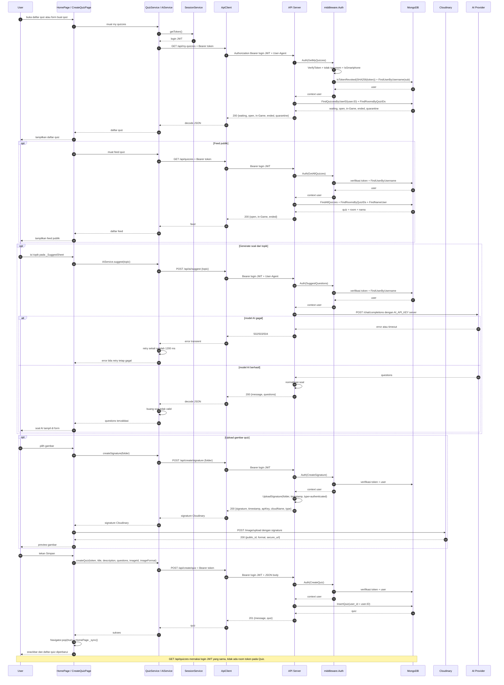

> Login JWT pada Quiz tidak berubah menjadi room token. Room token hanya diterbitkan oleh `POST /api/rooms/verify` dan hanya dipakai untuk WebSocket (§5.3–§5.4, §9).

**Alur end-to-end frontend → output:**

| Tahap | File/state | Nilai yang diisi/dipakai | Request | Output |
|---|---|---|---|---|
| Buka form | `lib/pages/Home/home_page.dart` | `_onCreateQuiz()` | — | `CreateQuizPage` terbuka |
| Isi quiz | `lib/pages/MyQuiz/create_quiz_page.dart` | `_titleController`, `_descriptionController`, `_questions` | — | Form terisi |
| Generate soal | `create_quiz_page.dart` + `ai_service.dart` | `_SuggestSheet` topik, `_suggest(topic)` | `POST /api/ai/suggest {topic}` | `_questions` diganti hasil AI |
| Upload gambar | `create_quiz_page.dart` | `_imageBytes`, `_imageUpload.publicId/format` | `POST /api/create/signature` lalu `POST /image/upload` ke Cloudinary | `image_id` + `image_format` |
| Simpan | `create_quiz_page.dart` + `quiz_service.dart` | `title`, `description`, `questions`, `imageId`, `imageFormat` | `POST /api/create/quiz` | `201 {message, quiz}` |
| Output | `home_page.dart` | `Navigator.pop(true)` lalu `_sync()` | — | Snackbar “Quiz berhasil dibuat” + daftar quiz diperbarui |

> `_selectedKategori` hanya dipakai untuk dropdown lokal dan **tidak dikirim** ke API. Gambar quiz wajib berhasil diunggah sebelum tombol Simpan dijalankan.

---

## 5. Room

### 5.1 POST /api/create/room

| Metode | Path | Auth |
|---|---|---|
| POST | `/api/create/room` | ✓ |

**Request body:**

| No | Field | Tipe | Wajib | Deskripsi |
|---|---|---|---|---|
| 1 | `quiz_id` | string (ObjectId) | ✅ | ID kuis yang dimainkan di room |
| 2 | `judul` | string | ✗ | Judul/header room |
| 3 | `isi` | string | ✗ | Deskripsi/isi room |
| 4 | `status` | string | ✗ | `waiting` (default), `open`, `in-Game`, `ended` |
| 5 | `type` | string | ✗ | `public` (default) atau `private`; menentukan apakah room tampil di feed publik |

**Contoh request:**

```http
POST /api/create/room HTTP/1.1
Host: localhost:8080
Authorization: Bearer <TOKEN>
Content-Type: application/json

{
  "quiz_id": "6651a0ab0000000000000000",
  "judul": "Room Ujian MongoDB",
  "isi": "Evaluasi konsep dasar NoSQL dan MongoDB.",
  "type": "public"
}
```

**Response:**

| Status | Deskripsi |
|---|---|
| 201 | Room dibuat |
| 400 | quiz_id kosong |
| 400 | quiz_id tidak valid |
| 400 | status tidak valid |
| 400 | tipe room tidak valid |
| 401 | Token tidak valid / sesi berakhir / bukan smartphone |
| 403 | Kuis bukan milik Anda (`Anda tidak punya akses ke kuis ini`) |
| 404 | Kuis tidak ada |
| 500 | Gagal membuat kode room / Gagal membuat room |

**Contoh response — `201 Created`**

```json
{
  "message": "Room berhasil dibuat",
  "room": {
    "id": "<id>",
    "quiz_id": "6651a0ab...",
    "quiz": {
      "id": "6651a0ab...",
      "title": "Kuis Pemrograman Mobile",
      "description": "Dasar Flutter & Dart",
      "path": "https://res.cloudinary.com/quiz/image/authenticated/s--abc123--/v123/galery-quiz/quiz-image/kuis-mobile.png",
      "total_questions": 10
    },
    "kode": "482913",
    "judul": "Room Soal Flutter",
    "isi": "Kumpulan soal dasar Flutter & Dart untuk persiapan ujian.",
    "status": "waiting",
    "type": "public",
    "created_at": "2026-09-17T10:00:00Z"
  }
}
```

**Contoh response — `400 Bad Request`**

```json
// quiz_id kosong
{ "message": "quiz_id wajib diisi" }

// quiz_id tidak valid
{ "message": "quiz_id tidak valid" }

// status tidak valid
{ "message": "Status room harus salah satu dari: waiting, open, in-Game, ended" }

// tipe room tidak valid
{ "message": "Tipe room harus salah satu dari: public, private" }
```

**Contoh response — `404 Not Found`**

```json
{ "message": "Kuis tidak ditemukan" }
```

### 5.2 PUT /api/room/{id}/status

| Metode | Path | Auth |
|---|---|---|
| PUT | `/api/room/{id}/status` | ✓ |

**Path parameter:**

| No | Parameter | Tipe | Wajib | Deskripsi |
|---|---|---|---|---|
| 1 | `id` | string (ObjectId) | ✅ | ID room (sumber kebenaran; selalu dipakai) |

**Request body:**

| No | Field | Tipe | Wajib | Deskripsi |
|---|---|---|---|---|
| 1 | `room_id` | string (ObjectId) | ✗ | Opsional; jika diisi wajib sama dengan `id` di path (bila beda → `400`) |
| 2 | `status` | string | ✅ | `waiting`, `open`, `in-Game`, `ended` |

**Contoh request:**

```http
PUT /api/room/6651a0ab0000000000000001/status HTTP/1.1
Host: localhost:8080
Authorization: Bearer <TOKEN>
Content-Type: application/json

{
  "room_id": "6651a0ab0000000000000001",
  "status": "in-Game"
}
```

**Response:**

| Status | Deskripsi |
|---|---|
| 200 | Status berubah |
| 400 | ID tidak valid |
| 400 | Status tidak valid |
| 400 | `room_id` di body tidak cocok dengan path |
| 401 | Token tidak valid / sesi berakhir / bukan smartphone |
| 403 | Room bukan milik Anda (`Anda tidak punya akses ke kuis ini`) |
| 404 | Room tidak ada |
| 500 | Gagal mengubah status room |

> Path `{id}` selalu menjadi sumber kebenaran; `room_id` di body hanya boleh sama dengan path.

**Contoh response — `200 OK`**

```json
{
  "message": "Status room berhasil diubah",
  "room": {
    "id": "<id>",
    "quiz_id": "6651a0ab...",
    "quiz": {
      "id": "6651a0ab...",
      "title": "Kuis Pemrograman Mobile",
      "description": "Dasar Flutter & Dart",
      "path": "https://res.cloudinary.com/quiz/image/authenticated/s--abc123--/v123/galery-quiz/quiz-image/kuis-mobile.png",
      "total_questions": 10
    },
    "kode": "482913",
    "judul": "Room Soal Flutter",
    "isi": "Kumpulan soal dasar Flutter & Dart untuk persiapan ujian.",
    "status": "in-Game",
    "type": "public",
    "created_at": "2026-09-17T10:00:00Z"
  }
}
```

**Contoh response — `400 Bad Request`**

```json
// ID tidak valid
{ "message": "ID room tidak valid" }

// Status tidak valid
{ "message": "Status room harus salah satu dari: waiting, open, in-Game, ended" }
```

**Contoh response — `404 Not Found`**

```json
{ "message": "Room tidak ditemukan" }
```

### 5.3 POST /api/rooms/verify

| Metode | Path | Auth |
|---|---|---|
| POST | `/api/rooms/verify` | ✓ |

Memverifikasi pin room. Pin adalah **kode room enam digit** yang dibuat saat room dibuat (§5.1). Bila kode cocok, server menerbitkan **JWT ber-scope room** (masa berlaku 1 jam) beserta data room. Token itu lalu dipakai klien untuk handshake WebSocket `GET /api/rooms?token=<JWT>` (§9).

**Request body:**

| No | Field | Tipe | Wajib | Deskripsi |
|---|---|---|---|---|
| 1 | `pin` | string | ✅ | Kode room enam digit, contoh `482913` |

**Contoh request:**

```http
POST /api/rooms/verify HTTP/1.1
Host: localhost:8080
Authorization: Bearer <TOKEN>
Content-Type: application/json

{
  "pin": "482913"
}
```

**Response:**

| Status | Deskripsi |
|---|---|
| 200 | Pin valid; token room + data room dikembalikan |
| 400 | `pin` kosong |
| 401 | Token login tidak valid / sesi berakhir / bukan smartphone |
| 404 | Tidak ada room dengan pin tersebut (`Room tidak ditemukan`) |
| 404 | Kuis room sudah tidak ada (`Kuis tidak ditemukan`) |
| 500 | Gagal memuat data room / kuis / Gagal membuat token room |

**Contoh response — `200 OK`**

```json
{
  "message": "Pin valid",
  "token": "<JWT room>",
  "room": {
    "id": "<id>",
    "quiz_id": "6651a0ab...",
    "quiz": {
      "id": "6651a0ab...",
      "title": "Kuis Pemrograman Mobile",
      "description": "Dasar Flutter & Dart",
      "path": "https://res.cloudinary.com/quiz/image/authenticated/s--abc123--/v123/galery-quiz/quiz-image/kuis-mobile.png",
      "total_questions": 10
    },
    "kode": "482913",
    "judul": "Room Soal Flutter",
    "isi": "Kumpulan soal dasar Flutter & Dart untuk persiapan ujian.",
    "status": "waiting",
    "type": "public",
    "created_at": "2026-09-17T10:00:00Z"
  }
}
```

> `token` adalah JWT ber-scope room (klaim `sub`=username, `room`=kode room, `typ`="room") dan **bukan** token login; token ini hanya berlaku untuk WebSocket `GET /api/rooms`.

**Contoh response — `400 Bad Request`**

```json
{ "message": "pin wajib diisi" }
```

**Contoh response — `404 Not Found`**

```json
{ "message": "Room tidak ditemukan" }
```

### 5.4 JWT Room (Token Ber-scope Room)

Token yang dikembalikan `POST /api/rooms/verify` (§5.3) adalah JWT yang **berbeda** dari token login dan hanya berlaku untuk handshake WebSocket `GET /api/rooms?token=<JWT room>` (§9.1).

**Klaim (claims):**

| Klaim | Tipe | Deskripsi |
|---|---|---|
| `sub` | string | Username pemilik token (diambil dari user yang login saat verifikasi) |
| `room` | string | Kode room enam digit; klaim inilah yang menentukan room tujuan WebSocket |
| `typ` | string | Selalu `"room"`, menandai token ber-scope room (bukan token login) |
| `iat` | number | Waktu terbit (Unix) |
| `exp` | number | Waktu kedaluwarsa (Unix); 1 jam setelah diterbitkan |

**Karakteristik:**

- Ditandatangani dengan `JWT_SECRET` yang sama seperti token login, tetapi klaim `typ="room"` membuatnya **tidak dapat dipakai** sebagai Bearer di endpoint `middleware.Auth` (token login tidak memakai klaim `typ`).
- Tidak disimpan di koleksi `tokens`, sehingga tidak ikut mekanisme logout/revocation; keamanannya bertumpu pada masa berlaku pendek (1 jam).
- Saat handshake WebSocket, klaim `sub` token room **wajib sama** dengan user pada token login; bila berbeda, handshake ditolak `403`.

**Contoh payload (decoded):**

```json
{
  "sub": "budi",
  "room": "482913",
  "typ": "room",
  "iat": 1760000000,
  "exp": 1760003600
}
```

### 5.5 POST /api/room/{kode}/answer

| Metode | Path | Auth |
|---|---|---|
| POST | `/api/room/{kode}/answer` | ✓ |

Dipakai klien untuk mengirim jawaban satu soal **selama permainan berjalan**. Permainan dibuka
saat host mengubah status room menjadi `in-Game` (§5.2) dan soal disiarkan server lewat WebSocket
(§9.1, pesan `question`). Klien menghitung sendiri **skor** soal (kecepatan menjawab × bobot ×
ketepatan) lalu mengirimkannya; server hanya mengakumulasi dengan penjagaan ringan. Sesi
permainan hidup **di memori** — server menjadi otoritas atas urutan soal, jeda papan peringkat,
dan akumulasi skor.

**Path parameter:**

| No | Parameter | Tipe | Wajib | Deskripsi |
|---|---|---|---|---|
| 1 | `kode` | string (6 digit) | ✅ | Kode room yang sedang bermain |

**Request body:**

| No | Field | Tipe | Wajib | Deskripsi |
|---|---|---|---|---|
| 1 | `question_index` | int | ✅ | Indeks soal yang dijawab (0-based); wajib sama dengan soal yang sedang berjalan |
| 2 | `selected_idx` | int | ✅ | Indeks opsi yang dipilih peserta (0–3) |
| 3 | `is_correct` | bool | ✅ | Benar/tidaknya jawaban (dihitung klien) |
| 4 | `elapsed_ms` | int | ✅ | Waktu menjawab dalam milidetik (dihitung klien) |
| 5 | `score` | int | ✅ | Skor soal hasil hitung klien (lihat penjagaan di bawah) |

**Contoh request:**

```http
POST /api/room/482913/answer HTTP/1.1
Host: localhost:8080
Authorization: Bearer <TOKEN>
Content-Type: application/json

{
  "question_index": 0,
  "selected_idx": 1,
  "is_correct": true,
  "elapsed_ms": 840,
  "score": 17
}
```

**Penjagaan skor (server),** karena skor dihitung klien:

- `score` dijepit ke rentang `0 .. skor soal` (`skor` pada soal, 1–50).
- Bila `elapsed_ms > duration×1000 + 2000` (toleransi latensi 2 detik), `score` dipaksa `0`.
- Satu peserta hanya boleh menjawab **sekali** per soal.

**Response:**

| Status | Deskripsi |
|---|---|
| 200 | Jawaban tersimpan |
| 400 | Kode room kosong |
| 401 | Token tidak valid / sesi berakhir / bukan smartphone |
| 404 | Permainan tidak sedang berjalan |
| 409 | Soal sedang tidak berjalan / soal sudah berganti / jawaban sudah dikirim |
| 415 | Content-Type bukan JSON |

**Contoh response — `200 OK`** (akumulasi skor peserta setelah jawaban ini)

```json
{
  "message": "Jawaban tersimpan",
  "score": 51,
  "correct": 3,
  "answered": 4
}
```

**Contoh response — `404 Not Found`**

```json
{ "message": "Permainan tidak sedang berjalan" }
```

**Contoh response — `409 Conflict`**

```json
// Soal sedang tidak berjalan (fase jeda)
{ "message": "Soal sedang tidak berjalan" }

// Mengirim indeks soal yang bukan soal berjalan
{ "message": "Soal sudah berganti" }

// Peserta sudah menjawab soal ini
{ "message": "Jawaban sudah dikirim" }
```

> **Penyimpanan hasil:** selama permainan, jawaban hanya diakumulasi di memori. Saat seluruh
> soal selesai (`game_end`), server menulis satu dokumen per peserta ke koleksi `game_results`
> dengan field `room_id`, `user_id`, `length_question`, `correct_count`, dan `user_poin`
> (skor final yang juga dikreditkan sebagai poin user). Penulisan bersifat upsert berdasarkan
> `room_id + user_id`, sehingga satu peserta hanya punya satu hasil per room. Tidak ada endpoint
> HTTP terpisah untuk menulis atau membaca koleksi ini.

### 5.6 Alur Token — Room

| Endpoint | Token yang dikirim | Token yang diterbitkan | Keterangan |
|---|---|---|---|
| `POST /api/create/room` | Login JWT | — | `user.ID` dari context dicek sebagai pemilik kuis |
| `PUT /api/room/{id}/status` | Login JWT | — | `user.ID` dari context dicek sebagai pemilik room/kuis |
| `POST /api/rooms/verify` | Login JWT | Room JWT (1 jam) | Pin diverifikasi; token ber-scope room diterbitkan |
| `POST /api/room/{kode}/answer` | Login JWT | — | Peserta ditentukan dari `sub`/username di context |
| `GET /api/rooms?token=...` | Login JWT + room JWT | — | Handshake WebSocket; rincian di §9.3 |

**Langkah alur token:**

1. Klien memakai login JWT untuk `POST /api/create/room` dan `PUT /api/room/{id}/status`. Setelah `middleware.Auth` memuat user, server memeriksa bahwa kuis/room yang diubah memang milik user tersebut (`403` bila bukan).
2. Untuk masuk ke room, klien mengirim login JWT + `pin` ke `POST /api/rooms/verify`.
3. Server memverifikasi login JWT, mencari room berdasarkan `pin`, lalu memastikan kuis room masih ada.
4. Server menerbitkan room JWT HS256 dengan klaim `sub` (username login), `room` (kode room), `typ="room"`, `iat`, dan `exp` 1 jam. Room JWT **tidak disimpan** di `tokens`, sehingga tidak ikut logout/revocation.
5. Room JWT hanya boleh dipakai pada query `?token=` saat handshake WebSocket. Token ini ditolak sebagai Bearer karena `middleware.Auth` menolak `typ="room"`.
6. `POST /api/room/{kode}/answer` tetap memakai login JWT, bukan room JWT. Server memakai username dari context sebagai identitas peserta; host tidak boleh menjawab.
7. Saat room JWT kedaluwarsa, klien harus memanggil ulang `POST /api/rooms/verify` untuk mendapatkan token room baru. Logout hanya mencabut login JWT, bukan room JWT.

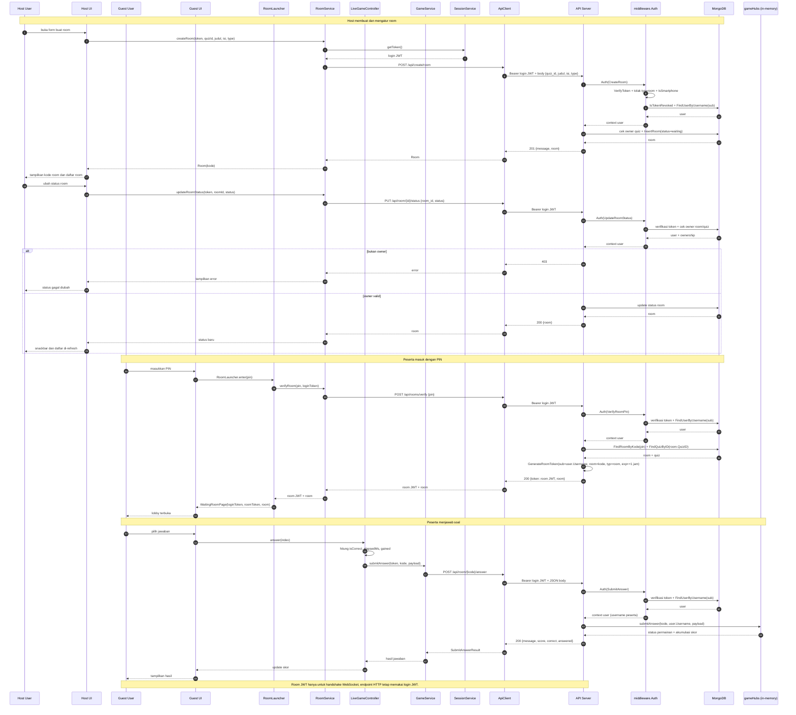

> Room JWT tidak dapat dipakai di endpoint HTTP Room sebagai pengganti login JWT. Endpoint `POST /api/room/{kode}/answer` tidak memerlukan room JWT karena room sudah ditentukan oleh path `{kode}` dan peserta oleh login JWT.

**Alur end-to-end frontend → output:**

| Tahap | File/state | Nilai yang diisi/dipakai | Request | Output |
|---|---|---|---|---|
| Buat room | `lib/pages/MyQuiz/create_room_sheet.dart` | `_selectedQuizId`, `_titleController`, `_descriptionController`, `_private` | `POST /api/create/room {quiz_id, judul, isi, type}` | `201 {room}` + dialog kode room |
| Ubah status | `lib/pages/MyQuiz/detail_room_page.dart` | `room.id`, status `waiting/open/in-Game/ended` | `PUT /api/room/{id}/status {room_id, status}` | Status room berubah dan daftar di-refresh |
| Masuk room | `lib/pages/Quiz/enter_pin_page.dart` | `_pinController.text` | `POST /api/rooms/verify {pin}` | `200 {token: room JWT, room}` |
| Buka lobby | `lib/helpers/room_launcher.dart` | `loginToken`, `result.token`, `WaitingRoomPage` | — | `WaitingRoomPage` menerima login token + room token |
| Jawab soal | `lib/services/live_game_controller.dart` | `question.index`, pilihan, `elapsedMs`, `score` | `POST /api/room/{kode}/answer` | `200 {message, score, correct, answered}` |

> Saat create room, `status` tidak dikirim; server memakai default `waiting`. `_private` dipetakan menjadi `type: "private"` atau dihilangkan untuk room publik.

---

## 6. Result

> Aturan: **1 kode room unik = maksimal 1 result** (dijamin unique index `results.kode`).

### 6.1 POST /api/room/{kode}/result

| Metode | Path | Auth |
|---|---|---|
| POST | `/api/room/{kode}/result` | ✓ |

**Path parameter:**

| No | Parameter | Tipe | Wajib | Deskripsi |
|---|---|---|---|---|
| 1 | `kode` | string (6 digit) | ✅ | Kode unik room, contoh `482913` |

**Request body:**

| No | Field | Tipe | Wajib | Deskripsi |
|---|---|---|---|---|
| 1 | `entries` | array | ✗ | Daftar skor peserta (boleh kosong saat dibuat) |
| 2 | `entries[].nama` | string | ✅ | Nama peserta |
| 3 | `entries[].skor` | int | ✗ | Skor peserta (0–100) |

**Contoh request:**

```http
POST /api/room/482913/result HTTP/1.1
Host: localhost:8080
Authorization: Bearer <TOKEN>
Content-Type: application/json

{
  "entries": [
    { "nama": "Budi", "skor": 80 },
    { "nama": "Ani", "skor": 70 }
  ]
}
```

**Response:**

| Status | Deskripsi |
|---|---|
| 201 | Result dibuat |
| 400 | Kode kosong |
| 400 | Nama peserta kosong / skor di luar 0–100 |
| 401 | Token tidak valid / sesi berakhir / bukan smartphone |
| 403 | Room bukan milik Anda (`Anda tidak punya akses ke kuis ini`) |
| 404 | Room tidak ditemukan |
| 409 | Room sudah punya result |
| 500 | Gagal memeriksa result / Gagal membuat result |

**Contoh response — `201 Created`**

```json
{
  "message": "Result berhasil dibuat",
  "result": {
    "id": "<id>",
    "room_id": "<room_id>",
    "kode": "482913",
    "quiz_id": "6651a0ab...",
    "entries": [
      { "nama": "Budi", "skor": 80 },
      { "nama": "Ani", "skor": 70 }
    ],
    "created_at": "2026-09-17T10:00:00Z"
  }
}
```

**Contoh response — `400 Bad Request`**

```json
// Kode kosong
{ "message": "Kode room wajib diisi" }

// Nama peserta kosong
{ "message": "nama peserta ke-1 wajib diisi" }

// Skor di luar 0-100
{ "message": "skor peserta ke-1 harus antara 0 sampai 100" }
```

**Contoh response — `404 Not Found`**

```json
{ "message": "Room tidak ditemukan" }
```

**Contoh response — `409 Conflict`**

```json
{ "message": "Room sudah memiliki result" }
```

### 6.2 GET /api/room/{kode}/result

| Metode | Path | Auth |
|---|---|---|
| GET | `/api/room/{kode}/result` | ✓ |

**Path parameter:**

| No | Parameter | Tipe | Wajib | Deskripsi |
|---|---|---|---|---|
| 1 | `kode` | string (6 digit) | ✅ | Kode unik room |

**Contoh request:**

```http
GET /api/room/482913/result HTTP/1.1
Host: localhost:8080
Authorization: Bearer <TOKEN>
```

**Response:**

| Status | Deskripsi |
|---|---|
| 200 | Result ditemukan |
| 400 | Kode kosong |
| 401 | Token tidak valid / sesi berakhir / bukan smartphone |
| 404 | Result tidak ada |
| 500 | Gagal memuat data result / Gagal memuat data kuis |

**Contoh response — `200 OK`**

```json
{
  "result": {
    "id": "<id>",
    "room_id": "<room_id>",
    "kode": "482913",
    "quiz_id": "6651a0ab...",
    "quiz": {
      "id": "6651a0ab...",
      "title": "Kuis Pemrograman Mobile",
      "description": "Dasar Flutter & Dart",
      "path": "https://res.cloudinary.com/quiz/image/authenticated/s--abc123--/v123/galery-quiz/quiz-image/kuis-mobile.png",
      "total_questions": 10
    },
    "entries": [
      { "nama": "Budi", "skor": 80 },
      { "nama": "Ani", "skor": 70 }
    ],
    "created_at": "2026-09-17T10:00:00Z"
  }
}
```

**Contoh response — `400 Bad Request`**

```json
{ "message": "Kode room wajib diisi" }
```

**Contoh response — `404 Not Found`**

```json
{ "message": "Result tidak ditemukan" }
```

### 6.3 PUT /api/room/{kode}/result

| Metode | Path | Auth |
|---|---|---|
| PUT | `/api/room/{kode}/result` | ✓ |

Upsert: jika result belum ada akan dibuat, jika sudah ada maka `entries` diganti.

**Path parameter:**

| No | Parameter | Tipe | Wajib | Deskripsi |
|---|---|---|---|---|
| 1 | `kode` | string (6 digit) | ✅ | Kode unik room |

**Request body:**

| No | Field | Tipe | Wajib | Deskripsi |
|---|---|---|---|---|
| 1 | `entries` | array | ✅ (setidaknya 1 valid) | Daftar skor peserta |
| 2 | `entries[].nama` | string | ✅ | Nama peserta |
| 3 | `entries[].skor` | int | ✗ | Skor peserta (0–100) |

**Contoh request:**

```http
PUT /api/room/482913/result HTTP/1.1
Host: localhost:8080
Authorization: Bearer <TOKEN>
Content-Type: application/json

{
  "entries": [
    { "nama": "Budi", "skor": 90 },
    { "nama": "Ani", "skor": 75 },
    { "nama": "Cici", "skor": 60 }
  ]
}
```

**Response:**

| Status | Deskripsi |
|---|---|
| 200 | Result diperbarui/baru |
| 400 | Kode kosong / nama kosong / skor di luar 0–100 |
| 401 | Token tidak valid / sesi berakhir / bukan smartphone |
| 403 | Room bukan milik Anda (`Anda tidak punya akses ke kuis ini`) |
| 404 | Room tidak ditemukan |
| 500 | Gagal memperbarui result / Gagal memuat data result |

**Contoh response — `200 OK`**

```json
{
  "result": {
    "id": "<id>",
    "room_id": "<room_id>",
    "kode": "482913",
    "quiz_id": "6651a0ab...",
    "quiz": {
      "id": "6651a0ab...",
      "title": "Kuis Pemrograman Mobile",
      "description": "Dasar Flutter & Dart",
      "path": "https://res.cloudinary.com/quiz/image/authenticated/s--abc123--/v123/galery-quiz/quiz-image/kuis-mobile.png",
      "total_questions": 10
    },
    "entries": [
      { "nama": "Budi", "skor": 90 },
      { "nama": "Ani", "skor": 75 },
      { "nama": "Cici", "skor": 60 }
    ],
    "created_at": "2026-09-17T10:00:00Z"
  }
}
```

**Contoh response — `400 Bad Request`**

```json
{ "message": "Kode room wajib diisi" }
```

**Contoh response — `404 Not Found`**

```json
{ "message": "Room tidak ditemukan" }
```

### 6.4 GET /api/results

| Metode | Path | Auth |
|---|---|---|
| GET | `/api/results` | ✓ |

**Query parameter (opsional):**

| No | Parameter | Tipe | Default | Deskripsi |
|---|---|---|---|---|
| 1 | `limit` | int ≥ 0 | tanpa batas | Batas jumlah result yang dikembalikan |
| 2 | `skip` | int ≥ 0 | 0 | Jumlah result yang dilewati |

**Contoh request:**

```http
GET /api/results?limit=20&skip=0 HTTP/1.1
Host: localhost:8080
Authorization: Bearer <TOKEN>
```

**Response:**

| Status | Deskripsi |
|---|---|
| 200 | Semua result |
| 400 | `limit` atau `skip` bukan bilangan bulat / di bawah 0 |
| 401 | Token tidak valid / sesi berakhir / bukan smartphone |
| 500 | Gagal memuat data result |

**Contoh response — `200 OK`**

```json
{
  "results": [
    {
      "id": "<id>",
      "room_id": "<room_id>",
      "kode": "482913",
      "quiz_id": "6651a0ab...",
      "entries": [
        { "nama": "Budi", "skor": 90 },
        { "nama": "Ani", "skor": 75 },
        { "nama": "Cici", "skor": 60 }
      ],
      "created_at": "2026-09-17T10:00:00Z"
    }
  ]
}
```

**Contoh response — `400 Bad Request`**

```json
// Limit tidak valid
{ "message": "limit tidak valid" }

// Skip tidak valid
{ "message": "skip tidak valid" }
```

**Contoh response — `401 Unauthorized`**

```json
{ "status": 401, "error": "Unauthorized", "message": "Missing or expired authorization token" }
```

### 6.5 Alur Token — Result

| Endpoint | Token yang dikirim | Otorisasi tambahan |
|---|---|---|
| `POST /api/room/{kode}/result` | Login JWT | `ownedRoom`: room → kuis harus milik user |
| `GET /api/room/{kode}/result` | Login JWT | Cukup autentikasi |
| `PUT /api/room/{kode}/result` | Login JWT | `ownedRoom`: room → kuis harus milik user |
| `GET /api/results` | Login JWT | Cukup autentikasi |

**Langkah alur token:**

1. Klien memperoleh login JWT dari `POST /api/login` dan mengirimnya sebagai Bearer pada seluruh endpoint Result.
2. `middleware.Auth` memverifikasi signature/exp, menolak `typ="room"`, mengecek `tokens.revoked_at`, memeriksa allowlist smartphone, lalu memuat user ke context.
3. `POST` dan `PUT` result memakai `user.ID` dari context untuk memanggil `ownedRoom`; jika room/kuis bukan milik user, server membalas `403`.
4. `GET /api/room/{kode}/result` dan `GET /api/results` hanya membutuhkan login JWT; tidak ada pengecekan kepemilikan tambahan.
5. Tidak ada room JWT pada service Result. Room ditentukan dari path `{kode}`, bukan dari klaim token.
6. Token yang hilang, rusak, kedaluwarsa, dicabut, atau berasal dari non-smartphone menghasilkan `401`.

**Diagram alur token REST dan statistik profil:**

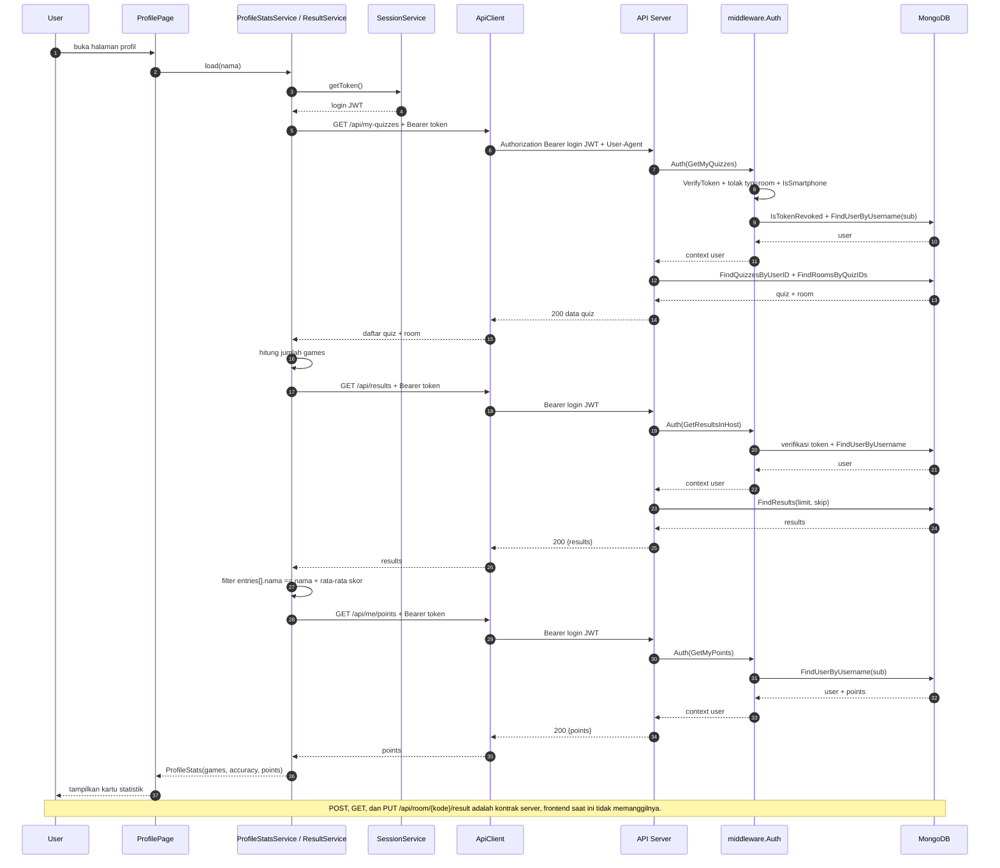

> Login JWT adalah satu-satunya token pada service Result. `GET` tidak memakai pengecekan owner; `POST`/`PUT` memakai user dari context untuk otorisasi.

**Alur end-to-end frontend → output:**

| Jalur | File/state | Nilai yang diisi/dipakai | Request | Output |
|---|---|---|---|---|
| Hasil live | `lib/pages/Quiz/live_quiz_page.dart` | `LiveGameEnd`, `myScore`, `myCorrect`, `myAnswered`, `roomTitle`, `isHost` | Pesan WebSocket `game_end` | `QuizResultPage`: podium, rank, akurasi, poin |
| Statistik profil | `lib/pages/Profiles/profile_page.dart` | `_nama`, `_stats` | `GET /api/results` + `GET /api/me/points` + `GET /api/my-quizzes` | Kartu `games`, `accuracy`, `points` |
| Backend-only | `lib/services/api/result_service.dart` | Hanya `fetchResults()` | `GET /api/results` | Dipakai profil; bukan scoreboard host |

> `POST /api/room/{kode}/result`, `GET /api/room/{kode}/result`, dan `PUT /api/room/{kode}/result` **tidak dipanggil frontend saat ini**. Hasil permainan live dibentuk dari pesan `game_end`, sedangkan statistik profil memakai `GET /api/results` dan mencocokkan `entries[].nama`.

**Diagram hasil live tanpa endpoint Result:**

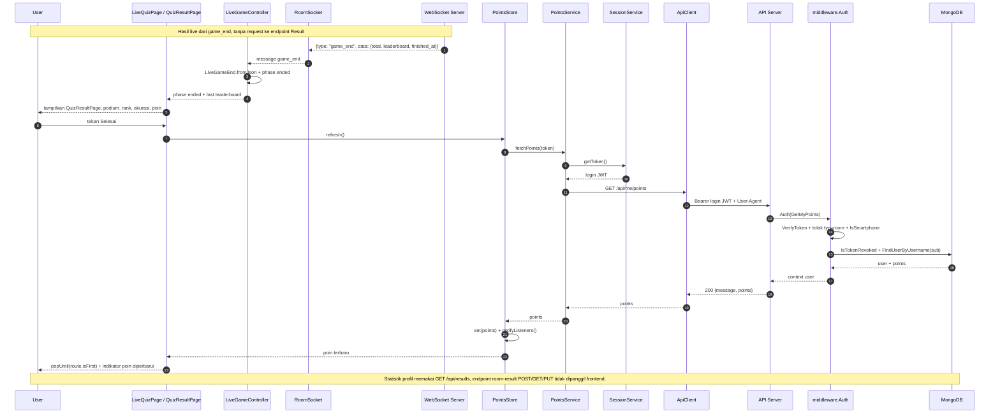

---

## 7. AI

### 7.1 POST /api/ai/suggest

| Metode | Path | Auth |
|---|---|---|
| POST | `/api/ai/suggest` | ✓ |

Endpoint ini dipanggil halaman **Create Quiz** dari aplikasi ketika pengguna
menekan tombol "Buat Soal dengan AI" lalu mengirim topik lewat bottom sheet.
Klien hanya mengirim **topik/ide teks bebas** (mis. `"Sejarah Majapahit"` atau
`"10 soal tentang Flutter"`). Server mengambil jumlah soal dari teks topik
lewat pola `N soal` (mis. `"10 soal tentang Flutter"` → 10 soal); bila topik
tidak memuat angka tersebut, dipakai **jumlah default 5** (maksimal 30; bila
lebih dari 30 permintaan ditolak). Server lalu meneruskan topik ke model AI dan
membalikkan daftar soal yang **sudah memenuhi aturan kuis (§4.4)**: tepat 4
opsi, `correct_idx` 0–3, `duration` ∈ {`1.5`, `2`, `3`, `5`}, dan `skor`
1–50.

Klien memakai hasil balikan ini untuk **mengganti seluruh isian pertanyaan**
pada form create quiz (auto-fill). Karena bergantung pada model AI, endpoint
ini dapat merespons lebih lama dari endpoint biasa — klien disarankan memakai
timeout ≥ 60 detik.

**Request body:**

| No | Field | Tipe | Wajib | Deskripsi |
|---|---|---|---|---|
| 1 | `topic` | string | ✅ | Topik/ide soal dalam bentuk teks bebas; jumlah soal diambil dari pola `N soal` (default 5, maksimal 30) |

**Contoh request:**

```http
POST /api/ai/suggest HTTP/1.1
Host: localhost:8080
Authorization: Bearer <TOKEN>
Content-Type: application/json

{
  "topic": "2 soal tentang Sejarah Majapahit"
}
```

**Response:**

| Status | Deskripsi |
|---|---|
| 200 | Berhasil; berisi daftar soal hasil AI |
| 400 | `topic` kosong / jumlah soal pada topik di luar rentang 1–30 |
| 401 | Token tidak valid / sesi berakhir / bukan smartphone |
| 415 | Content-Type bukan JSON |
| 502 | Model AI gagal merespons |
| 500 | Terjadi kesalahan server |

**Contoh response — `200 OK`**

```json
{
  "message": "Saran soal berhasil dibuat",
  "questions": [
    {
      "question": "Kerajaan Majapahit didirikan oleh siapa?",
      "options": ["Raden Wijaya", "Hayam Wuruk", "Gajah Mada", "Sri Kertanegara"],
      "correct_idx": 0,
      "duration": 3,
      "skor": 20
    },
    {
      "question": "Pada tahun berapa Kerajaan Majapahit didirikan?",
      "options": ["1293", "1350", "1400", "1478"],
      "correct_idx": 0,
      "duration": 2,
      "skor": 15
    }
  ]
}
```

**Contoh response — `400 Bad Request`**

```json
// topic kosong
{ "message": "Topik soal wajib diisi" }

// jumlah soal pada topik di luar rentang yang diizinkan (mis. "50 soal tentang Flutter")
{ "message": "Jumlah soal tidak valid" }
```

**Catatan klien:** soal yang tidak memenuhi bentuk dasar (question kosong
atau `options` tidak berjumlah 4) dibuang klien (`AiService`), bukan dijadikan
isian form. Field dengan nilai di luar aturan (`duration`, `skor`,
`correct_idx`) dinormalisasi ke nilai default yang aman sebelum ditampilkan.

### 7.2 Alur Token — AI

| Endpoint | Token yang dikirim | Keterangan |
|---|---|---|
| `POST /api/ai/suggest` | Login JWT | Hanya login JWT; tidak ada room token |

**Langkah alur token:**

1. Klien memperoleh login JWT dari `POST /api/login` dan mengirimnya sebagai Bearer ke `POST /api/ai/suggest`.
2. `middleware.Auth` memverifikasi signature/exp, menolak `typ="room"`, mengecek `tokens.revoked_at`, memeriksa allowlist smartphone, lalu memuat user ke context.
3. Handler memvalidasi `topic`; setelah itu server memanggil penyedia AI memakai `AI_API_KEY` dari environment server.
4. Login JWT klien **tidak** diteruskan ke penyedia AI. `AI_API_KEY` tidak pernah dikembalikan ke klien.
5. Tidak ada room token pada service AI. Token yang tidak valid/kedaluwarsa/dicabut atau request non-smartphone menghasilkan `401`.

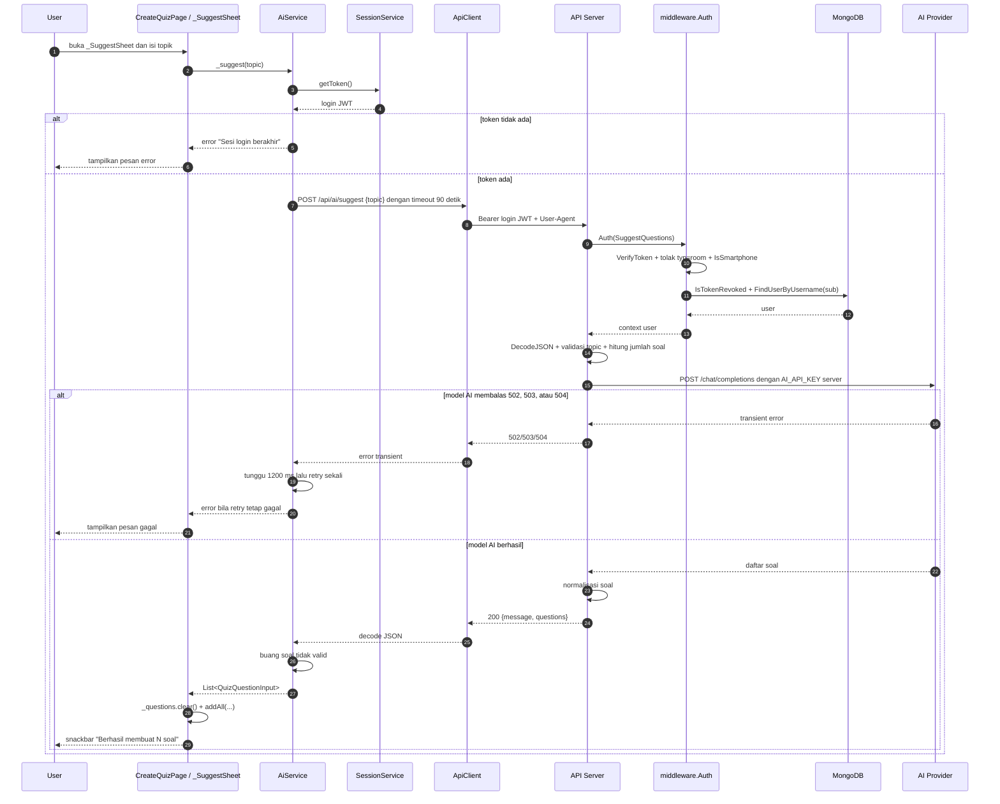

> Service AI tidak menerbitkan token baru. Satu-satunya token yang terlibat adalah login JWT; kredensial `AI_API_KEY` sepenuhnya berada di server.

**Alur end-to-end frontend → output:**

| Tahap | File/state | Nilai yang diisi/dipakai | Request | Output |
|---|---|---|---|---|
| Buka sheet | `lib/pages/MyQuiz/create_quiz_page.dart` | `_openSuggestSheet()` | — | `_SuggestSheet` tampil |
| Isi topik | `create_quiz_page.dart` | topik dari `_SuggestSheet` | — | `_suggest(topic)` dipanggil |
| Minta saran | `lib/services/api/ai_service.dart` | `token`, `topic`, timeout 90 detik | `POST /api/ai/suggest {topic}` | `200 {message, questions}` |
| Normalisasi | `ai_service.dart` | `question`, `options`, `correct_idx`, `duration`, `skor` | — | Soal tidak valid dibuang; nilai ekstrem dinormalisasi |
| Tampilkan | `create_quiz_page.dart` | `_questionFrom(input)` | — | `_questions` diganti hasil AI + snackbar jumlah soal |

> `AiService` mencoba ulang **sekali** setelah 1200 ms bila server membalas `502`, `503`, atau `504`. Hasil AI belum disimpan ke database sampai user menekan Simpan dan `POST /api/create/quiz` berhasil.

---

## 8. Emoji

Koleksi `emojis` menyimpan referensi emoji yang asetnya berupa berkas `.gif` di Cloudinary.
Setiap dokumen memiliki `nama` (boleh berisi karakter emoji) dan `path` (URL/path aset yang
berakhiran `.gif`). Kredensial Cloudinary diatur lewat env `CLOUDINARY_URL` (atau
`CLOUDINARY_CLOUD_NAME` + `CLOUDINARY_API_KEY` + `CLOUDINARY_API_SECRET`); endpoint di bawah
hanya membaca/menulis metadata di MongoDB.

### 8.1 GET /api/emojis

| Metode | Path | Auth |
|---|---|---|
| GET | `/api/emojis` | ✓ |

Tidak ada request parameter. Daftar diurutkan dari yang terbaru (`created_at` desc).

**Contoh request:**

```http
GET /api/emojis HTTP/1.1
Host: localhost:8080
Authorization: Bearer <TOKEN>
```

**Response:**

| Status | Deskripsi |
|---|---|
| 200 | Semua emoji |
| 401 | Token tidak valid / sesi berakhir / bukan smartphone |

**Contoh response — `200 OK`**

```json
{
  "emojis": [
    {
      "id": "<id>",
      "nama": "😀",
      "path": "https://res.cloudinary.com/demo/image/upload/v123/muka-senyum.gif",
      "created_at": "2026-09-17T10:00:00Z"
    }
  ]
}
```

### 8.2 GET /api/emojis/{id}

| Metode | Path | Auth |
|---|---|---|
| GET | `/api/emojis/{id}` | ✓ |

**Path parameter:**

| No | Parameter | Tipe | Wajib | Deskripsi |
|---|---|---|---|---|
| 1 | `id` | string (ObjectId) | ✅ | ID dokumen emoji |

**Contoh request:**

```http
GET /api/emojis/6651a0ab0000000000000002 HTTP/1.1
Host: localhost:8080
Authorization: Bearer <TOKEN>
```

**Response:**

| Status | Deskripsi |
|---|---|
| 200 | Emoji ditemukan |
| 400 | ID kosong / tidak valid |
| 401 | Token tidak valid / sesi berakhir / bukan smartphone |
| 404 | Emoji tidak ada |

**Contoh response — `200 OK`**

```json
{
  "emoji": {
    "id": "6651a0ab0000000000000002",
    "nama": "😀",
    "path": "https://res.cloudinary.com/demo/image/upload/v123/muka-senyum.gif",
    "created_at": "2026-09-17T10:00:00Z"
  }
}
```

**Contoh response — `400 Bad Request`**

```json
// ID kosong
{ "message": "ID emoji wajib diisi" }

// ID tidak valid
{ "message": "ID emoji tidak valid" }
```

**Contoh response — `404 Not Found`**

```json
{ "message": "Emoji tidak ditemukan" }
```

### 8.3 POST /api/emojis

| Metode | Path | Auth |
|---|---|---|
| POST | `/api/emojis` | ✓ |

Tanpa upload file: `path` diisi URL/path aset Cloudinary yang sudah ada dan wajib berakhiran `.gif`.
Aturan unik `emojis.path` membuat path yang sama tidak bisa didaftarkan dua kali.

**Request body:**

| No | Field | Tipe | Wajib | Deskripsi |
|---|---|---|---|---|
| 1 | `nama` | string | ✅ | Nama/label emoji (boleh berisi karakter emoji) |
| 2 | `path` | string | ✅ | URL/path aset Cloudinary, wajib berakhiran `.gif` |

**Contoh request:**

```http
POST /api/emojis HTTP/1.1
Host: localhost:8080
Authorization: Bearer <TOKEN>
Content-Type: application/json

{
  "nama": "😀",
  "path": "https://res.cloudinary.com/demo/image/upload/v123/muka-senyum.gif"
}
```

**Response:**

| Status | Deskripsi |
|---|---|
| 201 | Emoji dibuat |
| 400 | `nama` kosong / `path` kosong / `path` tidak berakhiran `.gif` |
| 401 | Token tidak valid / sesi berakhir / bukan smartphone |
| 409 | Path sudah terdaftar |
| 413 | Body terlalu besar (> 1 MiB) |
| 415 | Content-Type bukan JSON |
| 500 | Gagal membuat emoji |

**Contoh response — `201 Created`**

```json
{
  "message": "Emoji berhasil dibuat",
  "emoji": {
    "id": "<id>",
    "nama": "😀",
    "path": "https://res.cloudinary.com/demo/image/upload/v123/muka-senyum.gif",
    "created_at": "2026-09-17T10:00:00Z"
  }
}
```

**Contoh response — `400 Bad Request`**

```json
// Nama kosong
{ "message": "nama emoji wajib diisi" }

// Path kosong
{ "message": "path emoji wajib diisi" }

// Path bukan .gif
{ "message": "path emoji wajib diakhiri .gif" }
```

**Contoh response — `409 Conflict`**

```json
{ "message": "Emoji dengan path ini sudah ada" }
```

### 8.4 Alur Token — Emoji

| Endpoint | Token yang dikirim | Keterangan |
|---|---|---|
| `GET /api/emojis` | Login JWT | Cukup autentikasi |
| `GET /api/emojis/{id}` | Login JWT | Cukup autentikasi |
| `POST /api/emojis` | Login JWT | Cukup autentikasi; tidak ada pengecekan owner |

**Langkah alur token:**

1. Klien memperoleh login JWT dari `POST /api/login` dan mengirimnya sebagai Bearer pada seluruh endpoint Emoji.
2. `middleware.Auth` memverifikasi signature/exp, menolak `typ="room"`, mengecek `tokens.revoked_at`, memeriksa allowlist smartphone, lalu memuat user ke context.
3. Handler Emoji hanya membaca/menulis metadata di MongoDB; tidak ada operasi upload Cloudinary dan tidak ada kredensial Cloudinary yang dikirim ke klien.
4. Tidak ada room token maupun pengecekan kepemilikan pada service Emoji. Semua user yang login dapat memanggil ketiga endpoint.
5. Token yang hilang, rusak, kedaluwarsa, dicabut, atau request non-smartphone menghasilkan `401`.

**Diagram kontrak REST Emoji, tidak dipanggil frontend:**

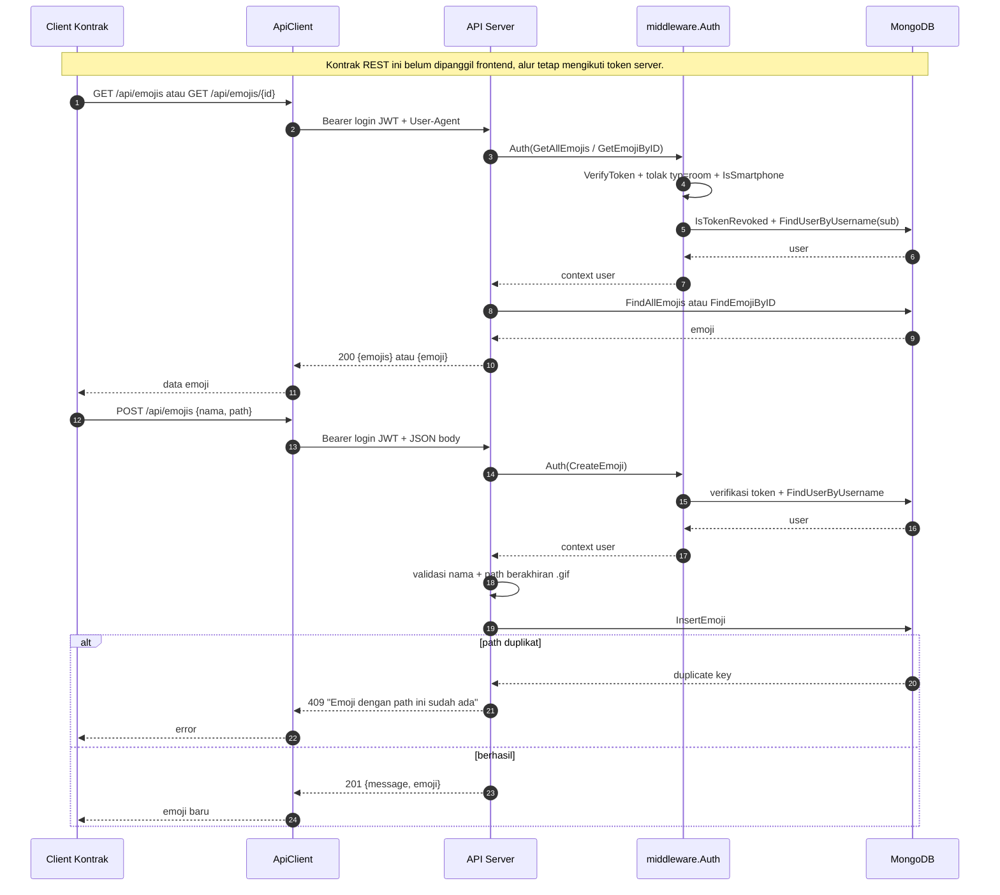

> Service Emoji tidak memakai room token. Login JWT hanya menjadi gerbang autentikasi; tidak ada data emoji yang dimiliki per user.

**Alur end-to-end frontend → output:**

| Tahap | File/state | Nilai yang diisi/dipakai | Request | Output |
|---|---|---|---|---|
| Pilih reaksi | `lib/pages/Quiz/waiting_room_page.dart` | `_cheers` (`_sendCheer`) | — | Overlay lokal langsung tampil |
| Kirim reaksi | `lib/services/api/room_socket.dart` | `sendReaction(emoji)` | WS `{type: "reaction", data: {emoji}}` | Diteruskan server ke klien lain |
| Terima reaksi | `room_socket.dart` | `_onData`, `RoomMessage.fromJson` | — | `ReactionOverlay.show` di room yang sama |
| REST Emoji | `lib/services/api/*` | Tidak ada caller | `GET/POST /api/emojis` | Tidak dipakai UI saat ini |

> Endpoint REST Emoji **tidak dipanggil frontend**. Reaksi memakai WebSocket; server memperlakukan tipe `reaction` sebagai broadcast ke klien lain. Pengirim menampilkan reaksinya sendiri secara lokal agar terasa instan.

**Diagram reaksi WebSocket yang dipakai frontend:**

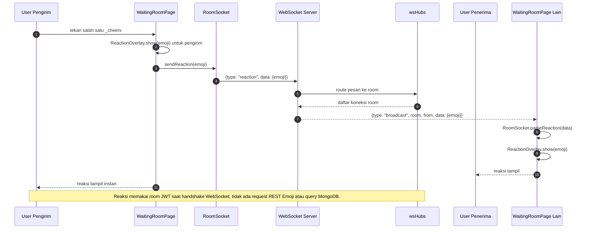

---

## 9. WebSocket

Endpoint WebSocket melakukan *handshake* HTTP Upgrade lalu berpindah ke frame WebSocket.
Autentikasi memakai JWT lewat header `Authorization: Bearer <token>`,
dan asal (Origin) handshake dibatasi oleh env `ALLOWED_ORIGINS` bila diset.

### 9.1 GET /api/rooms?token=<JWT room>

| Item | Nilai |
|---|---|
| Protokol | `ws://` (HTTP) atau `wss://` (HTTPS, saat `cert.pem` tersedia) |
| Auth | ✅ Header `Authorization: Bearer <token>` (JWT login) **dan** query `token=<JWT room>` |
| Query param | `token` (wajib, JWT ber-scope room dari `POST /api/rooms/verify` §5.3 — lihat §5.4), `name` (opsional, default username pemilik token) |

Room ditentukan oleh klaim `room` pada JWT room di query `token`. Klaim `sub` JWT room wajib
sama dengan user yang sedang login (header `Authorization`). Kode room divalidasi harus ada di
database; jika tidak, handshake ditolak `404 { "message": "Room tidak ditemukan" }` sebelum upgrade.
Karena `middleware.Auth` juga menerapkan allowlist device, handshake ditolak `401`
`{ "message": "Akses hanya diizinkan dari perangkat smartphone" }` bila bukan dari smartphone.

Tanpa/`token` room tidak valid handshake ditolak `401` (`Token room tidak ditemukan` / `Token room tidak valid`);
bila `sub` JWT room berbeda dengan user login, ditolak `403` (`Token room bukan milik pengguna ini`).

Contoh: `ws://localhost:8080/api/rooms?token=<JWT room>&name=klien-a` (sertakan header `Authorization: Bearer <JWT login>`).

#### Format pesan

Semua pesan berupa JSON dengan bentuk yang sama:

| Field | Tipe | Keterangan |
|---|---|---|
| `type` | string | Jenis pesan |
| `room` | string | Kode room (dikirim server) |
| `from` | string | Nickname pengirim (dikirim server) |
| `time` | string | Waktu server format RFC3339 (dikirim server) |
| `data` | any | Payload bebas (dikirim klien) |
| `users` | number | Jumlah koneksi aktif di room (dikirim server) |
| `names` | string[] | Daftar nickname klien yang sudah terhubung di room, dikirim server **hanya pada pesan `connected`** agar klien baru langsung mengenal penghuni room sebelumnya (klien menambahkan dirinya sendiri ke daftar) |

#### Pesan dari klien

| `type` | Contoh | Balasan server |
|---|---|---|
| `ping` | `{"type":"ping","data":1}` | `pong` ke pengirim |
| `echo` | `{"type":"echo","data":"hai"}` | `echo` ke pengirim |
| `count` | `{"type":"count"}` | `count` ke pengirim |
| `broadcast` | `{"type":"broadcast","data":"halo"}` | `broadcast` ke klien **lain** di room yang sama |

Tipe lain diperlakukan sebagai `broadcast`. Payload yang bukan JSON dibalas dengan `error`.

#### Pesan dari server

| `type` | Kapan dikirim |
|---|---|
| `connected` | Saat koneksi upgraded, sebelum apa pun. `users` sudah termasuk dirinya sendiri; `names` berisi nickname klien yang sudah terhubung sebelumnya |
| `join` | Saat klien lain masuk ke room yang sama |
| `leave` | Saat klien lain keluar dari room |
| `question` | Soal baru dibuka saat permainan berjalan (lihat §9.2) |
| `round_result` | Satu ronde selesai; berisi kunci jawaban + papan peringkat sementara dan jeda sebelum soal berikutnya (lihat §9.2) |
| `game_end` | Permainan selesai; berisi papan peringkat akhir (lihat §9.2) |

#### Contoh respons

```json
{"type":"connected","room":"482913","from":"klien-a","time":"2026-10-04T18:53:12+07:00","users":1}
{"type":"connected","room":"482913","from":"klien-b","time":"2026-10-04T18:53:13+07:00","users":2,"names":["klien-a"]}
{"type":"broadcast","room":"482913","from":"klien-b","time":"2026-10-04T18:53:14+07:00","data":"halo"}
```

Server mengirim frame `Ping` otomatis tiap 54 detik; klien harus menjawab `Pong`. Koneksi yang tidak
menjawab dalam 60 detik akan ditutup. Ukuran pesan maksimal 8192 byte.

Tes cepat (perlu header Authorization login, JWT room di query, dan User-Agent smartphone):

```bash
wscat -c "ws://localhost:8080/api/rooms?token=<JWT room>&name=klien-a" \
  -H "Authorization: Bearer <JWT login>" \
  -H "User-Agent: Mozilla/5.0 (Linux; Android 13) AppleWebKit/537.36 Mobile Safari/537.36"
```

### 9.2 Alur Permainan (Game)

Permainan dimulai ketika host mengubah status room menjadi `in-Game` lewat `PUT /api/room/{id}/status`
(§5.2). Server lalu menjalankan permainan secara **otoritatif** dan menyiarkannya ke semua klien di
room lewat WebSocket:

1. Server menyiarkan `question` (soal ke-`index`), lalu menunggu selama `duration` detik.
2. Selama soal terbuka, tiap peserta mengirim jawaban lewat `POST /api/room/{kode}/answer` (§5.5).
3. Saat waktu soal habis, server menyiarkan `round_result` (kunci jawaban + papan peringkat
   sementara) dan berhenti selama `next_in_ms` (5000 ms) sebelum soal berikutnya.
4. Langkah 1–3 diulang sampai soal habis; server menyiarkan `game_end`, menandai room `ended`,
   menyimpan ringkasan hasil tiap peserta ke `game_results`, lalu mengkreditkan **poin**
    (dan mencatat poin) ke tiap peserta sesuai skor (§10). Poin hanya disimpan di MongoDB,
    bukan di blockchain.

Peserta yang baru terhubung saat permainan berjalan otomatis didaftarkan ke papan peringkat
(ikut dari ronde berikutnya). **Host (pemilik kuis) tidak didaftarkan ke papan peringkat**:
host hanya memandu sesi, tidak menjawab soal, tidak muncul di leaderboard, dan tidak menerima
kredit poin; jawaban dari username host ditolak `409 Host tidak ikut bermain`. Bila host
mengubah status room ke `ended` sebelum permainan tamat,
sesi dihentikan tanpa kredit poin.

> `correct_idx` **sengaja ikut dikirim** pada `question` dan `round_result` karena skor soal
> dihitung klien (§5.5). Papan peringkat diurutkan skor desc, lalu jumlah benar desc, lalu nama asc;
> `rank` dimulai dari 1.

**`question`**

```json
{
  "type": "question",
  "room": "482913",
  "time": "2026-10-05T20:00:00+07:00",
  "data": {
    "index": 0,
    "total": 10,
    "question": "Bahasa pemrograman utama Flutter?",
    "options": ["Kotlin", "Dart", "Swift", "Java"],
    "correct_idx": 1,
    "duration": 1.5,
    "max_score": 20,
    "expires_at": 1760000001500
  }
}
```

`expires_at` adalah epoch **milidetik** kapan soal ditutup. `max_score` = bobot (`skor`) soal.

**`round_result`**

```json
{
  "type": "round_result",
  "room": "482913",
  "time": "2026-10-05T20:00:02+07:00",
  "data": {
    "round": 0,
    "total": 10,
    "correct_idx": 1,
    "next_in_ms": 5000,
    "leaderboard": [
      { "rank": 1, "username": "124240200", "nama": "Budi", "score": 20, "correct": 1, "answered": 1 }
    ]
  }
}
```

**`game_end`**

```json
{
  "type": "game_end",
  "room": "482913",
  "time": "2026-10-05T20:03:00+07:00",
  "data": {
    "total": 10,
    "finished_at": "2026-10-05T20:03:00+07:00",
    "leaderboard": [
      { "rank": 1, "username": "124240200", "nama": "Budi", "score": 150, "correct": 8, "answered": 10 }
    ]
  }
}
```

### 9.3 Alur Token — WebSocket

| Tahap | Endpoint/Aksi | Token yang dikirim | Token yang diterbitkan |
|---|---|---|---|
| 1 | `POST /api/login` | — | Login JWT (24 jam) |
| 2 | `POST /api/rooms/verify` | Login JWT | Room JWT (1 jam) |
| 3 | `GET /api/rooms?token=...` | Login JWT + room JWT | — |

**Langkah alur token:**

1. Klien login ke `POST /api/login` dan menyimpan login JWT.
2. Klien mengirim login JWT + `pin` ke `POST /api/rooms/verify` untuk mendapatkan room JWT.
3. Room JWT berisi `sub` (username), `room` (kode room), `typ="room"`, dan `exp` 1 jam; token ini tidak disimpan di database.
4. Klien membuka `GET /api/rooms?token=<room JWT>` dengan header `Authorization: Bearer <login JWT>`, `User-Agent` smartphone, dan opsional `name`.
5. `middleware.Auth` memvalidasi login JWT lebih dulu: signature/exp, menolak `typ="room"`, mengecek `tokens.revoked_at`, memeriksa allowlist smartphone, lalu memuat user ke context.
6. Handler WebSocket membaca `?token=`, memanggil `VerifyRoomToken`, dan mewajibkan `typ="room"` serta klaim `sub` + `room` ada.
7. Server membandingkan `sub` room JWT dengan username login. Jika berbeda → `403 Token room bukan milik pengguna ini`.
8. Server mencari room berdasarkan klaim `room`. Jika tidak ada → `404 Room tidak ditemukan` sebelum upgrade.
9. Jika semua valid, server melakukan upgrade dan mengirim frame `connected`. Login JWT menentukan identitas user; room JWT hanya menentukan room tujuan.
10. Room JWT kedaluwarsa setelah 1 jam dan tidak bisa dicabut lewat logout. Logout hanya mencabut login JWT. Untuk sesi baru, klien memanggil ulang `POST /api/rooms/verify`; bila login JWT dicabut/kedaluwarsa, handshake ditolak `401`.

**Diagram handshake WebSocket dengan login JWT dan room JWT:**

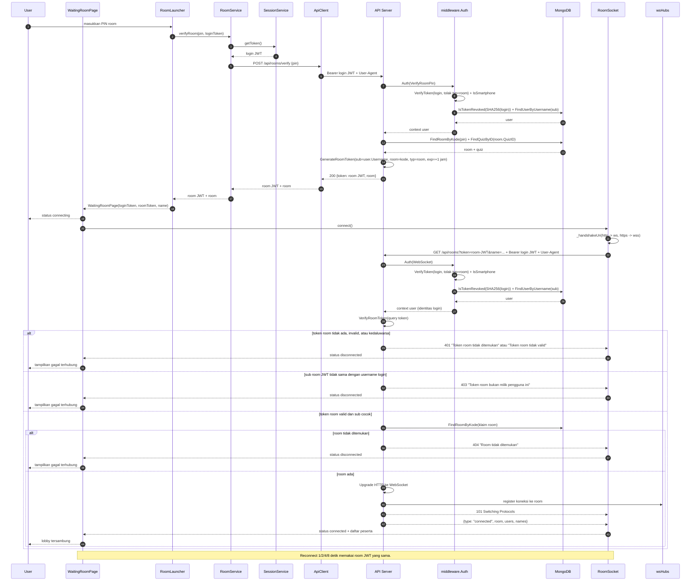

> Ringkasnya: login JWT = identitas user; room JWT = scope room. Keduanya wajib pada handshake. Room JWT tidak dapat dipakai sebagai Bearer dan tidak ikut revocation logout.

**Alur end-to-end frontend → output (koneksi):**

| Tahap | File/state | Nilai yang diisi/dipakai | Request | Output |
|---|---|---|---|---|
| Masuk room | `lib/helpers/room_launcher.dart` | `loginToken`, `pin` | `POST /api/rooms/verify` | `room JWT` + data room |
| Buat socket | `lib/pages/Quiz/waiting_room_page.dart` | `RoomSocket(roomToken, loginToken, name)` | — | Status `connecting` |
| Handshake | `lib/services/api/room_socket.dart` | `roomToken`, `loginToken`, `name` | `GET /api/rooms?token=...&name=...` | `101` + frame `connected` |
| Tampilkan lobby | `waiting_room_page.dart` | `_status`, `_names`, `_users` | — | Indikator tersambung + daftar peserta |

**Alur end-to-end frontend → output (permainan):**

| Tahap | File/state | Nilai yang diisi/dipakai | Request | Output |
|---|---|---|---|---|
| Mulai game | `detail_room_page.dart` | status `in-Game` | `PUT /api/room/{id}/status` | Server mulai game loop |
| Terima soal | `lib/services/live_game_controller.dart` | `_question`, `_maxDuration`, timer | WS `question` | Soal + pilihan tampil |
| Jawab | `live_game_controller.dart` | `selectedIndex`, `isCorrect`, `elapsedMs`, `score` | `POST /api/room/{kode}/answer` | `200 {message, score, correct, answered}` |
| Ronde selesai | `live_game_controller.dart` | `_roundResult`, `_lastLeaderboard` | WS `round_result` | Kunci jawaban + leaderboard sementara |
| Game selesai | `live_game_controller.dart` | `_gameEnd` | WS `game_end` | `QuizResultPage` |

> `SubmitAnswer` tetap memakai **login JWT**, bukan room JWT. Skor dihitung klien lalu diakumulasi server; kegagalan satu request jawaban tidak menghentikan permainan. Reconnect `RoomSocket` memakai room JWT yang sama dan belum memverifikasi ulang PIN.

**Diagram permainan dan pengiriman jawaban:**

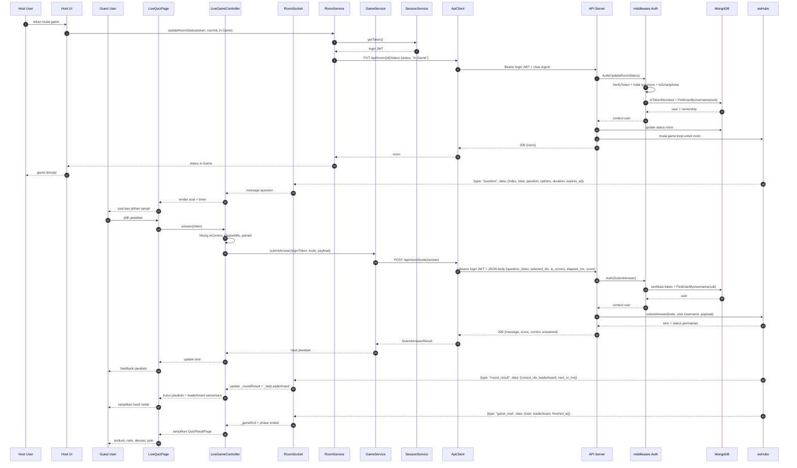

---

## 10. Poin & Rupiah

Poin disimpan sebagai riwayat di koleksi `points`, bukan di blockchain. Saldo poin
dihitung dengan rumus:

```text
total = sum(amount where reason = quiz_reward)
      - sum(amount where reason = redeem)
```

- `amount` selalu **positif**.
- `quiz_reward` menambah saldo; hadiah game hanya ditulis ke MongoDB (ledger `points`), tanpa transaksi blockchain.
- `redeem` mengurangi saldo; baris ini ditulis setelah klaim rupiah berhasil di blockchain.
- Baris `quiz_reward` dari alur game menyertakan `room_kode` dan `quiz_id`.
- Baris `redeem` dikirim tanpa `room_kode` atau `quiz_id`.
- `users.points` adalah cache legacy. Hadiah game dan klaim tidak lagi memperbaruinya; saldo poin otoritatif dihitung dari koleksi `points` (`GET /api/me/points`).
- Saldo rupiah disimpan di kontrak `WalletClaim` per alamat wallet. `users.rupiah_balance` tidak lagi dipakai sebagai cache oleh endpoint wallet/klaim.

### 10.1 GET /api/me/points

| Metode | Path | Auth |
|---|---|---|
| GET | `/api/me/points` | ✓ |

Tidak ada request parameter. Mengembalikan total poin user yang login sebagai angka.

**Contoh request:**

```http
GET /api/me/points HTTP/1.1
Host: localhost:8080
Authorization: Bearer <TOKEN>
```

**Response:**

| Status | Deskripsi |
|---|---|
| 200 | Total poin |
| 401 | Token tidak valid / sesi berakhir / bukan smartphone |
| 500 | Gagal membaca riwayat poin |

**Contoh response — `200 OK`**

```json
{
  "message": "Saldo poin",
  "points": 120
}
```

> Nilai `points` dihitung ulang dari koleksi `points` pada setiap request. Klien tidak menerima
> daftar riwayat lewat endpoint ini.

### 10.2 Ledger Poin (internal)

Koleksi `points` tidak diekspos sebagai endpoint publik. Setiap baris berisi `user_id`, `amount`,
`reason`, `room_kode`, `quiz_id`, `created_at`, `prev_hash`, dan `hash` yang membentuk rantai
SHA-256 per user. `reason` yang dipakai saat ini adalah `quiz_reward` dan `redeem`; konstanta
`refund` disediakan untuk pemakaian mendatang. Penulisan baris untuk user yang sama diserialisasi
agar `prev_hash` tidak bercabang saat ada dua pencatatan bersamaan.

Aturan metadata:

- `quiz_reward`: alur game mengirim `room_kode` dan `quiz_id`; `quiz_id` divalidasi sebagai ObjectID bila diisi.
- `redeem`: alur klaim mengirim `room_kode` dan `quiz_id` kosong.
- `amount` selalu positif; `redeem` dikurangkan saat menghitung saldo.

Hadiah game bersifat idempoten: satu user hanya mendapat satu baris `quiz_reward` per `room_kode`,
dan tidak ada transaksi blockchain untuk hadiah game. Klaim poin menulis satu baris `redeem` setelah
transaksi on-chain sukses; `amount` diambil dari `pointsClaimed` pada riwayat terakhir kontrak, dengan
fallback ke `points_to_claim`. Pengurangan rupiah tanpa penukaran poin tidak menulis baris `points`.
Jika penulisan ledger gagal, response klaim tetap sukses karena transaksi on-chain sudah final;
kegagalan hanya dicatat di log server.

### 10.3 Alur Token — Poin

| Endpoint | Token yang dikirim | Keterangan |
|---|---|---|
| `GET /api/me/points` | Login JWT | Saldo dihitung dari riwayat milik `user.ID` di context |

**Langkah alur token:**

1. Klien memperoleh login JWT dari `POST /api/login` dan mengirimnya sebagai Bearer.
2. `middleware.Auth` memverifikasi signature/exp, menolak `typ="room"`, mengecek `tokens.revoked_at`, memeriksa allowlist smartphone, lalu memuat user ke context.
3. `GET /api/me/points` memakai `user.ID` dari context untuk mengambil riwayat dan menghitung saldo; tidak ada `user_id` dari klien yang dipakai.
4. Tidak ada room token pada service ini. Token yang hilang, rusak, kedaluwarsa, dicabut, atau request non-smartphone menghasilkan `401`.

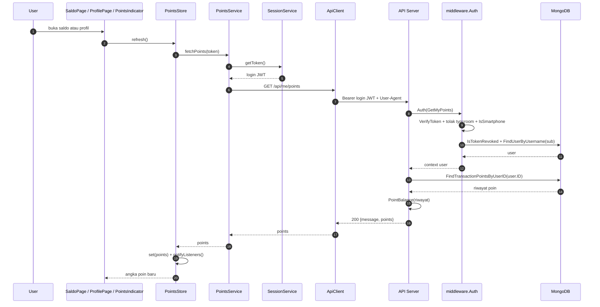

> Poin tidak menerbitkan token baru. Login JWT menentukan user yang saldonya dihitung; tidak ada `user_id` dari klien yang dipakai.

**Alur end-to-end frontend → output:**

| Tahap | File/state | Nilai yang diisi/dipakai | Request | Output |
|---|---|---|---|---|
| Refresh poin | `lib/services/points_store.dart` | `PointsStore.refresh()` | `GET /api/me/points` | `PointsIndicator` dan kartu profil diperbarui |
| Buka saldo | `lib/pages/Saldo/saldo_page.dart` | `_load()` | `GET /api/me/points` + `GET /api/wallet/{user}` | Saldo poin + saldo rupiah |
| Statistik profil | `lib/services/profile_stats_service.dart` | `fetchPoints(token)` | `GET /api/me/points` | Field `points` pada `ProfileStats` |

> Poin bertambah otomatis saat `game_end` dan dicatat sebagai `quiz_reward` di ledger. `users.points` tidak ikut diperbarui. Frontend tidak pernah mengirim `user_id`; server memakai user dari context hasil verifikasi login JWT.

---

## 11. Grouped Leaderboard Wilayah (LBS)

> Bagian ini mendefinisikan kontrak **LBS Grouped Leaderboard** yang dipakai klien
> (`LocationService` di `lib/services/api/location_service.dart`) untuk halaman **Peringkat Wilayah**.
> Koordinat diambil dari GPS perangkat (`geolocator`) lalu dikirim sebagai query parameter;
> server menentukan wilayah administratif device, menyimpan lokasi terakhir user, lalu
> mengembalikan leaderboard user yang dikelompokkan per kecamatan, kota, dan provinsi.
> Server memakai **OpenStreetMap** (Nominatim) untuk reverse geocoding wilayah user. Hasil
> di-cache di memori (TTL, `OSM_CACHE_TTL`, default 24 jam) dan permintaan Nominatim dijeda
> minimal satu detik sesuai kebijakan penggunaan OSM, sehingga klien **wajib menampilkan
> atribusi "© OpenStreetMap contributors"**.

### 11.1 GET /api/location

| Metode | Path | Auth |
|---|---|---|
| GET | `/api/location` | ✓ |

**Headers:**

| Header | Wajib | Keterangan |
|---|---|---|
| `Authorization` | ✓ | `Bearer <JWT_TOKEN>` |
| `Accept` | ✗ | `application/json` (server selalu membalas JSON) |

**Query parameters:**

| Parameter | Tipe | Wajib | Keterangan | Contoh |
|---|---|---|---|---|
| `latitude` | float | ✓ | Lintang GPS device, rentang −90 s.d. 90 | `-7.795580` |
| `longitude` | float | ✓ | Bujur GPS device, rentang −180 s.d. 180 | `110.369490` |

**Contoh request:**

```http
GET /api/location?latitude=-7.795580&longitude=110.369490 HTTP/1.1
Host: localhost:8080
Authorization: Bearer <TOKEN>
Accept: application/json
```

**Response:**

| Status | Deskripsi |
|---|---|
| 200 | Grouped leaderboard berhasil dibuat |
| 400 | `latitude`/`longitude` tidak dikirim, tidak dapat di-parse, atau di luar rentang |
| 401 | Token hilang/rusak/kedaluwarsa / sesi berakhir / bukan smartphone |
| 429 | Terlalu banyak permintaan (lihat header `Retry-After`; batas 10 permintaan per user per menit) |
| 500 | Error server |
| 502 | Layanan lokasi (OpenStreetMap) tidak tersedia / belum dikonfigurasi |

**Contoh response — `200 OK`**

```json
{
  "status": 200,
  "message": "Grouped leaderboard successfully retrieved",
  "metadata": {
    "user_location": {
      "latitude": -7.79558,
      "longitude": 110.36949
    },
    "resolved_regions": {
      "kecamatan": "kecamatan-depok",
      "kota": "kota-sleman",
      "provinsi": "provinsi-diy"
    },
    "timestamp": "2026-10-20T06:30:00Z"
  },
  "data": {
    "kecamatan": [
      {
        "rank": 1,
        "username": "ahmad_fauzi",
        "nama": "Ahmad Fauzi",
        "poin": 1450,
        "jarak_meter": 350.2
      }
    ],
    "kota": [
      {
        "rank": 1,
        "username": "budi_sleman",
        "nama": "Budi Santoso",
        "poin": 4890,
        "jarak_meter": 4500.0
      }
    ],
    "provinsi": [
      {
        "rank": 1,
        "username": "dewi_jogja",
        "nama": "Dewi Lestari",
        "poin": 18200,
        "jarak_meter": 12500.0
      }
    ]
  }
}
```

> `metadata.user_location` meng-echo koordinat yang dikirim pemanggil.
> `metadata.resolved_regions` berisi **slug** tiga wilayah hasil reverse geocoding
> (`kecamatan-depok`, `kota-sleman`, `provinsi-diy`); ketiga kunci selalu ada dan bernilai
> `""` bila wilayah tidak terdeteksi. `metadata.timestamp` adalah waktu server format
> RFC 3339 (UTC).
>
> `data` selalu memuat ketiga grup sebagai array (bukan `null`). Tiap entri:
> `rank` mulai 1, terurut `poin` menurun dengan tie-break `username` naik; `username`;
> `nama`; `poin`; dan `jarak_meter` = jarak haversine dari koordinat device ke lokasi
> terakhir user tersebut (`0` bila user belum pernah melaporkan lokasi). Maksimal **100
> entri per grup**.
>
> Setiap pemanggilan endpoint menyimpan lokasi terakhir pemanggil (`last_lat`, `last_lon`,
> dan slug ketiga wilayahnya) ke dokumen user, sehingga user otomatis masuk pada grup yang
> sama pada permintaan berikutnya. Grup yang slug-nya kosong selalu `[]`.

**Contoh response — `400 Bad Request`**

```json
{
  "status": 400,
  "error": "Bad Request",
  "message": "Latitude and longitude query parameters are required"
}
```

**Contoh response — `401 Unauthorized`**

```json
// Token hilang / tidak valid / kedaluwarsa
{
  "status": 401,
  "error": "Unauthorized",
  "message": "Missing or expired authorization token"
}

// Sesi berakhir
{
  "status": 401,
  "error": "Unauthorized",
  "message": "Sesi telah berakhir, silakan login kembali"
}
```

**Contoh response — `500 Internal Server Error`**

```json
{ "message": "Gagal menentukan wilayah lokasi" }
```

**Contoh response — `502 Bad Gateway`**

```json
{ "message": "Layanan lokasi tidak tersedia" }
```

**Contoh response — `429 Too Many Requests`**

```json
{ "message": "Terlalu banyak permintaan lokasi, coba lagi nanti" }
```

### 11.2 Alur Token — LBS

| Endpoint | Token yang dikirim | Keterangan |
|---|---|---|
| `GET /api/location` | Login JWT | Tidak ada room token; user ditentukan dari `sub` di login JWT |

**Langkah alur token:**

1. Klien memperoleh login JWT dari `POST /api/login` dan menyimpannya di `SharedPreferences` dengan key `auth_token`.
2. Halaman `RankingRegionPage` memanggil `SessionService.instance.getToken()`. Bila token kosong, request tidak dikirim.
3. `LocationService.locate()` meminta izin GPS lalu mengambil `Position` perangkat (latitude/longitude). `accuracy` tersedia di objek posisi tetapi **tidak dikirim** ke API; yang dikirim hanya `latitude` dan `longitude`.
4. `LocationService.submit()` memanggil `GET /api/location?latitude=<lat>&longitude=<lon>` melalui `ApiClient.get(token: token)`.
5. `ApiClient.headers` menambahkan `Authorization: Bearer <login JWT>` dan `User-Agent` smartphone. `middleware.Auth` memvalidasi token, revocation, allowlist device, lalu memuat user ke context.
6. Server memakai user dari context untuk menyimpan lokasi terakhir dan membatasi rate limit per user (10 request/menit). Tidak ada `user_id` dari klien.
7. Respons sukses disimpan sebagai cache `region_location` oleh frontend. Token tidak valid/kedaluwarsa/dicabut menghasilkan `401`; terlalu sering memanggil menghasilkan `429`.

**Alur end-to-end frontend → output:**

| Tahap | File/state | Nilai yang diisi/dipakai | Request | Output |
|---|---|---|---|---|
| Buka halaman | `lib/pages/Profiles/ranking_region_page.dart` | `_opened`, `_location` | — | Minta izin GPS sekali |
| Ambil posisi | `ranking_region_page.dart` | `_refreshLocation()` | `LocationService.locate(token)` | `Position(latitude, longitude)` |
| Kirim lokasi | `lib/services/api/location_service.dart` | `latitude`, `longitude` | `GET /api/location?latitude=...&longitude=...` | `200 {metadata, data}` |
| Simpan cache | `location_service.dart` | key `region_location` | — | `LocationResult` |
| Tampilkan | `ranking_region_page.dart` | `_location`, `_activeLevel` | — | Leaderboard kecamatan/kota/provinsi |

> `accuracy` dari GPS **tidak** masuk query API. Filter wilayah di UI memakai `_activeLevel`; data mentah berasal dari respons server yang sudah dikelompokkan.

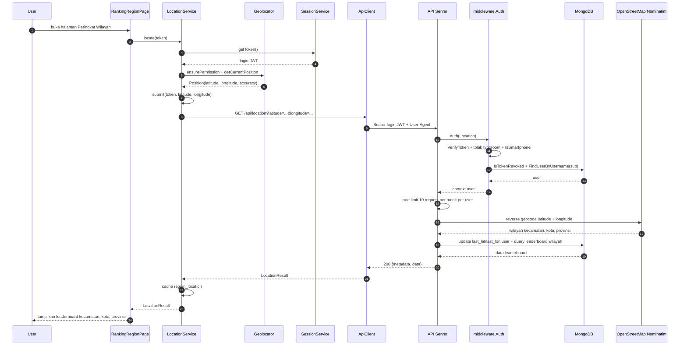

> `accuracy` dari GPS tidak termasuk query API. Login JWT adalah satu-satunya token pada LBS; tidak ada room token.

---

## 12. Kode Error Umum

| Kode | Arti | Contoh pesan |
|---|---|---|
| 400 | Request/atribut tidak valid | `Request tidak valid` / `Status room harus salah satu dari: waiting, open, in-Game, ended` / `Tipe room harus salah satu dari: public, private` |
| 401 | Autentikasi gagal atau sesi berakhir | `Missing or expired authorization token` / `Sesi telah berakhir, silakan login kembali` / `User tidak ditemukan` — envelope `{ "status": 401, "error": "Unauthorized", "message": "..." }` (endpoint dengan `middleware.Auth`) / `Token room tidak ditemukan` / `Token room tidak valid` (WebSocket, bentuk lama) |
| 401 | Bukan dari perangkat smartphone (allowlist device) | `Akses hanya diizinkan dari perangkat smartphone` |
| 403 | Otorisasi gagal (resource bukan milik Anda / perangkat lain) | `Anda tidak punya akses ke kuis ini` / `Token room bukan milik pengguna ini` / `Akun sudah terikat pada perangkat lain` |
| 404 | Data tidak ditemukan | `Kuis tidak ditemukan` / `Room tidak ditemukan` / `Result tidak ditemukan` / `Emoji tidak ditemukan` / `Permainan tidak sedang berjalan` |
| 409 | Konflik data (duplikat / state permainan) | `Username sudah terdaftar` / `Room sudah memiliki result` / `Emoji dengan path ini sudah ada` / `Soal sedang tidak berjalan` / `Soal sudah berganti` / `Jawaban sudah dikirim` |
| 413 | Body request terlalu besar (> 1 MiB) | `Body request terlalu besar (maksimal 1 MiB)` |
| 415 | Content-Type bukan JSON | `Content-Type harus application/json` |
| 429 | Rate limit terlampaui | `Terlalu banyak percobaan login, coba lagi nanti` |
| 500 | Error server | `Gagal membuat akun` / `Gagal membuat room` / `Gagal membuat token room` |

> Semua endpoint yang menerima body JSON memakai validator yang sama sehingga dapat mengembalikan `413` dan `415` di luar daftar contoh per-endpoint di atas. Endpoint dengan `middleware.Auth` juga dapat mengembalikan `401` allowlist device. Endpoint `POST /image/upload` (§4.3) disediakan Cloudinary, bukan oleh server ini.

---

## 13. Ringkasan Alur Token User → Frontend → Server → User

Alur umum yang berlaku untuk semua service:

1. Halaman Flutter mengisi variabel (controller/state), lalu memanggil service Dart (`lib/services/api/*.dart`).
2. Service mengambil login JWT dari `SessionService.instance.getToken()` (key `SharedPreferences`: `auth_token`).
3. `ApiClient.headers()` menambahkan `Authorization: Bearer <login JWT>`, `Content-Type: application/json` bila ada body, dan `User-Agent` smartphone dari `DeviceService.instance.userAgent`.
4. Body di-encode dengan `jsonEncode`; path memakai `ApiClient.baseUrl` (`https://deera-server.my.id`).
5. `middleware.Auth` memvalidasi token dan memuat user; handler memakai user dari context untuk identitas/ownership.
6. Room JWT hanya dibuat oleh `POST /api/rooms/verify` dan hanya dipakai pada query WebSocket; token ini tidak disimpan di `SharedPreferences` sebagai pengganti login JWT.

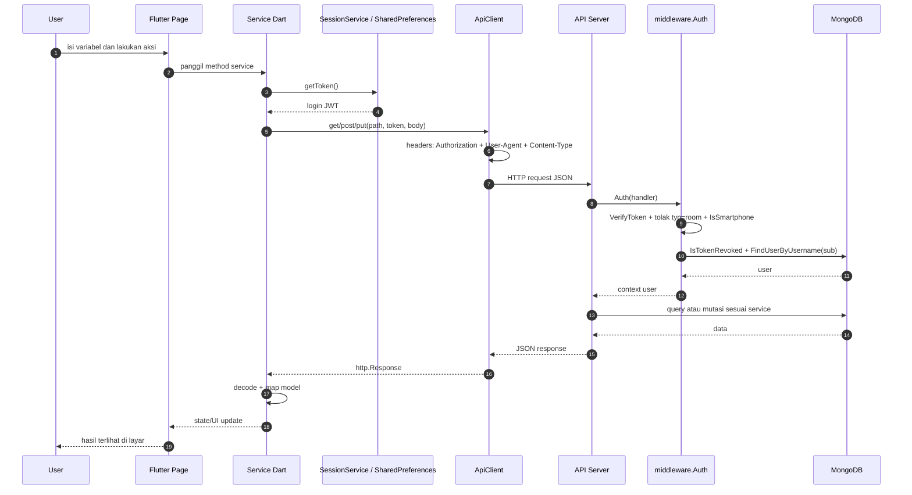

Dokumentasi ini mencakup endpoint backend Golang untuk mengelola dompet digital pengguna, melakukan klaim poin menjadi rupiah yang tercatat permanen di blockchain, serta melihat riwayat transaksinya.

## 14. Ambil Informasi Dompet, Saldo, dan Riwayat

Endpoint ini digunakan oleh aplikasi Flutter untuk menampilkan saldo rupiah dan riwayat transaksi on-chain milik user. Identitas user diambil dari login JWT, bukan dipercaya dari path. Nilai `{user}` wajib sama dengan username (atau ObjectID) user yang login; jika berbeda server membalas `403`.

- `current_balance` adalah saldo rupiah **terkini** dari `balancesOf(address)` on-chain. Jika RPC gagal, endpoint membalas `502`; tidak memakai cache `users.rupiah_balance`.
- `data` adalah array riwayat transaksi on-chain dari event `BalanceChanged` kontrak `WalletClaim` yang aktif. Hanya transaksi on-chain yang sukses yang muncul.
- Setiap item berisi `_id`, `user_id`, `points_claimed`, `rupiah_value`, `status`, dan `created_at`.
- `_id` dibuat sintetis dengan format `<tx_hash>:<log_index>`; `tx_hash` dan `explorer_url` tidak lagi menjadi field terpisah.
- `rupiah_value` bisa bernilai negatif untuk pengurangan rupiah tanpa penukaran poin.
- `data` diurutkan dari event terbaru (block/log terbesar) lebih dulu. Belum ada pagination.
- Endpoint ini tidak mengembalikan `game_points`, `wallet_address`, atau envelope `transactions`. Gunakan `GET /api/me/points` untuk saldo poin. Riwayat audit MongoDB `transactions` tidak lagi ditulis oleh alur klaim.

Server mendeteksi blok deploy kontrak secara otomatis lewat `eth_getCode` (binary search)
dan memindai event per rentang blok; tidak ada env tambahan untuk blok deploy. Riwayat
on-chain berasal dari kontrak yang sedang aktif di `WALLET_CONTRACT_ADDRESS`.

```
GET /api/wallet/{user}
Host: localhost:8080
Authorization: Bearer <TOKEN>
Accept: application/json
```

### Path Parameters

| Nama Parameter | Tipe Data | Deskripsi |
| ----- | ----- | ----- |
| `user` | String | Username (atau ObjectID) user yang login. Contoh: `user_123` |

### Contoh Response (200 OK)

```
{
  "status": "SUCCESS",
  "current_balance": 10000,
  "data": [
    {
      "_id": "0x88d9c24e83f...3f1a:12",
      "user_id": "user_123",
      "points_claimed": 1000,
      "rupiah_value": 10000,
      "status": "SUCCESS",
      "created_at": "2026-10-25T11:34:00Z"
    },
    {
      "_id": "0x12ab34cd56e...9f0b:3",
      "user_id": "user_123",
      "points_claimed": 0,
      "rupiah_value": -5000,
      "status": "SUCCESS",
      "created_at": "2026-10-24T09:10:00Z"
    }
  ]
}

```

> `rupiah_value` pada riwayat bisa bernilai negatif untuk transaksi pengurangan rupiah
> (`points_to_claim = 0`). `points_claimed = 0` pada transaksi tersebut. Semua baris
> `data` adalah transaksi sukses on-chain. Hash transaksi dan log index tersedia di `_id`;
> klien dapat membentuk URL explorer sendiri bila diperlukan.

### Contoh Response Error

```
// user pada path kosong (400)
{ "error": "user wajib diisi" }

// user pada path bukan milik token (403)
{ "error": "user_id tidak sesuai dengan pengguna yang login" }

// wallet_address user belum diatur (400)
{ "error": "wallet_address pengguna belum diatur" }

// wallet_address bukan alamat EVM valid (400)
{ "error": "wallet_address pengguna tidak valid" }

// blockchain belum dikonfigurasi (503)
{ "error": "Layanan blockchain belum dikonfigurasi" }

// gagal membaca saldo rupiah dari RPC (502)
{ "error": "Gagal membaca saldo rupiah di blockchain" }

// gagal membaca event riwayat dari RPC (502)
{ "error": "Gagal memuat riwayat blockchain" }
```

### Cara Testing (`cURL`)

```
curl -X GET http://localhost:8080/api/wallet/user_123 \
  -H "Authorization: Bearer <TOKEN>" \
  -H "User-Agent: Mozilla/5.0 (Linux; Android 13) AppleWebKit/537.36 Mobile Safari/537.36" \
  -H "Content-Type: application/json"

```

## 15. Klaim Poin & Pengurangan Rupiah (Withdraw / Settlement)

Endpoint ini digunakan untuk menukar poin menjadi rupiah atau mengurangi saldo rupiah.
Backend **tidak** mendebit `users.points` dan **tidak** memvalidasi saldo poin ledger sebelum
transaksi. Alur yang dijalankan:

1. Validasi kombinasi `points_to_claim`/`rupiah_value` dan `wallet_address` user.
2. Panggil `applyDelta(address userWallet, user_id, rupiahDelta, pointsClaimed)` pada kontrak
   `WalletClaim` di Base Sepolia. `pointsClaimed` hanya menjadi metadata event; state on-chain
   yang berubah adalah saldo rupiah.
3. Jika transaksi sukses dan `points_to_claim > 0`, server membaca `getLastMyHistory()` lalu
   menulis satu baris `redeem` ke ledger `points` (hash dirantai ke baris terakhir user yang sama).
4. Jika penulisan ledger gagal, response tetap `200` karena transaksi on-chain sudah final;
   kegagalan hanya dicatat di log server.

Bila env blockchain belum lengkap, endpoint membalas `503`.

```
POST /api/wallet/claim
Host: localhost:8080
Authorization: Bearer <TOKEN>
Accept: application/json
Content-Type: application/json
```

### Payload Request (JSON)

| Field | Tipe | Wajib | Deskripsi |
|---|---|---|---|
| `user_id` | string | ✗ | Opsional demi kompatibilitas; bila diisi wajib sama dengan user login |
| `points_to_claim` | integer | ✗ | Default `0`. Nilai `> 0` menukar poin; nilai `0` dipakai untuk pengurangan rupiah. Maksimal `1.000.000.000` |
| `rupiah_value` | number | ✗ | Saat `points_to_claim > 0`: harus sama dengan `points_to_claim × WALLET_RUPIAH_PER_POINT`; `0`/kosong dihitung server. Saat `points_to_claim = 0`: wajib negatif |

**Aturan kombinasi:**

| `points_to_claim` | `rupiah_value` | Efek |
|---|---|---|
| `> 0` | `> 0` (sesuai kurs) | Rupiah on-chain bertambah; ledger `points` menulis `redeem` setelah chain sukses |
| `0` | `< 0` | Rupiah berkurang, poin tetap; **tidak** menulis ledger `points` |
| `0` | `≥ 0` | Ditolak `400` |
| `> 0` | `< 0` | Ditolak `400` |

**Contoh tukar poin:**

```
{
  "user_id": "user_123",
  "points_to_claim": 1000,
  "rupiah_value": 10000.0
}

```

**Contoh pengurangan rupiah tanpa menukar poin:**

```
{
  "user_id": "user_123",
  "points_to_claim": 0,
  "rupiah_value": -5000.0
}

```

### Contoh Response (200 OK)

```
{
  "status": "SUCCESS",
  "message": "Klaim berhasil dan tercatat permanen di blockchain!",
  "tx_hash": "0x88d9c24e83f...3f1a",
  "remaining_points": 500
}

```

> `remaining_points` berasal dari cache `users.points` yang dimuat middleware, bukan saldo
> ledger dan tidak diperbarui oleh endpoint ini. Gunakan `GET /api/me/points` untuk saldo poin
> otoritatif. Pada pengurangan rupiah tanpa penukaran poin, nilainya sama dengan cache sebelumnya.

### Contoh Response Error

```
// points_to_claim negatif atau terlalu besar (400)
{ "error": "points_to_claim tidak boleh negatif" }
{ "error": "points_to_claim terlalu besar" }

// saldo rupiah on-chain tidak cukup untuk pengurangan (400)
{ "error": "Saldo rupiah tidak mencukupi" }

// kombinasi points_to_claim/rupiah_value tidak valid (400)
{ "error": "rupiah_value harus negatif saat points_to_claim nol" }
{ "error": "rupiah_value tidak boleh negatif saat menukar poin" }
{ "error": "rupiah_value tidak sesuai dengan konversi poin" }
{ "error": "rupiah_value terlalu kecil" }
{ "error": "rupiah_value terlalu besar" }
{ "error": "rupiah_value harus lebih dari nol" }

// wallet_address user belum diatur / bukan alamat EVM valid (400)
{ "error": "wallet_address pengguna belum diatur" }
{ "error": "wallet_address pengguna tidak valid" }

// user_id tidak cocok dengan token (403)
{ "error": "user_id tidak sesuai dengan pengguna yang login" }

// transaksi on-chain gagal (502); tidak ada poin lokal yang didebit/dikembalikan
{ "error": "Gagal mencatat klaim ke blockchain" }

// gagal membaca saldo rupiah on-chain sebelum pengurangan (502)
{ "error": "Gagal memeriksa saldo rupiah di blockchain" }

// transaksi sudah terkirim tetapi receipt belum diterima (502);
// status PENDING/FAILED tidak lagi disimpan di MongoDB
{ "error": "Transaksi klaim sedang diproses di blockchain" }

// env blockchain belum diisi (503)
{ "error": "Layanan blockchain belum dikonfigurasi" }
```

### Cara Testing (`cURL`)

```
curl -X POST http://localhost:8080/api/wallet/claim \
  -H "Authorization: Bearer <TOKEN>" \
  -H "User-Agent: Mozilla/5.0 (Linux; Android 13) AppleWebKit/537.36 Mobile Safari/537.36" \
  -H "Content-Type: application/json" \
  -d '{
    "user_id": "user_123",
    "points_to_claim": 1000,
    "rupiah_value": 10000.0
  }'

```

**Pengurangan rupiah:**

```
curl -X POST http://localhost:8080/api/wallet/claim \
  -H "Authorization: Bearer <TOKEN>" \
  -H "User-Agent: Mozilla/5.0 (Linux; Android 13) AppleWebKit/537.36 Mobile Safari/537.36" \
  -H "Content-Type: application/json" \
  -d '{
    "user_id": "user_123",
    "points_to_claim": 0,
    "rupiah_value": -5000.0
  }'

```
**Diagram end-to-end per service:**

| Service | Bagian |
|---|---|
| Auth | §3.5 |
| Quiz | §4.6 |
| Room | §5.6 |
| Result | §6.5 |
| AI | §7.2 |
| Emoji | §8.4 |
| WebSocket | §9.3 |
| Poin & Rupiah | §10.3 |
| LBS | §11.2 |
| Wallet & Klaim | §14–§15 |

